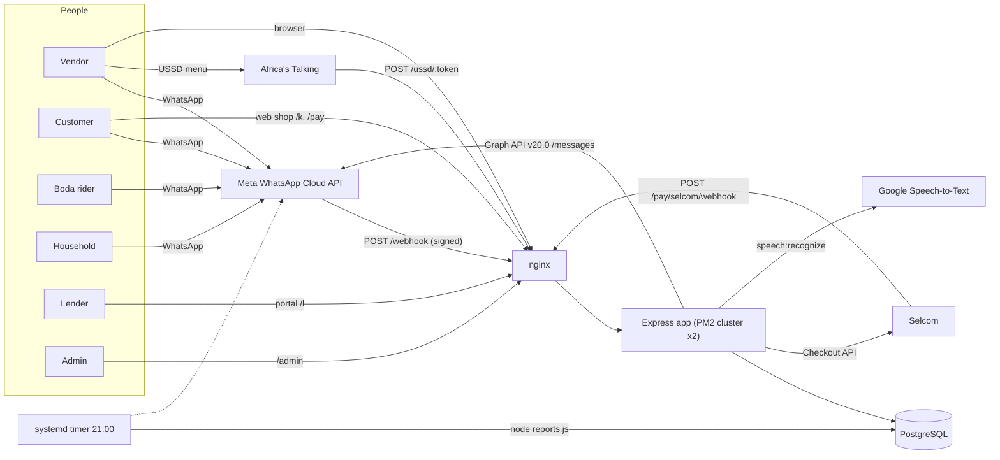
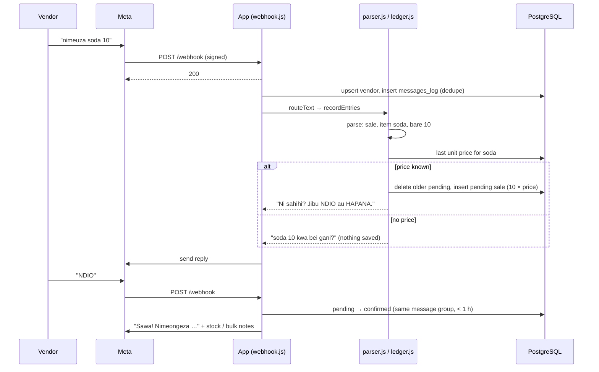
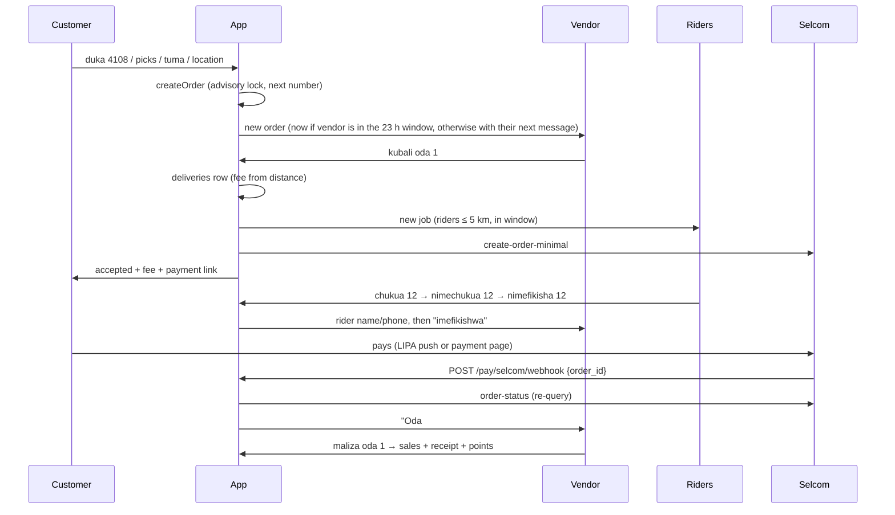
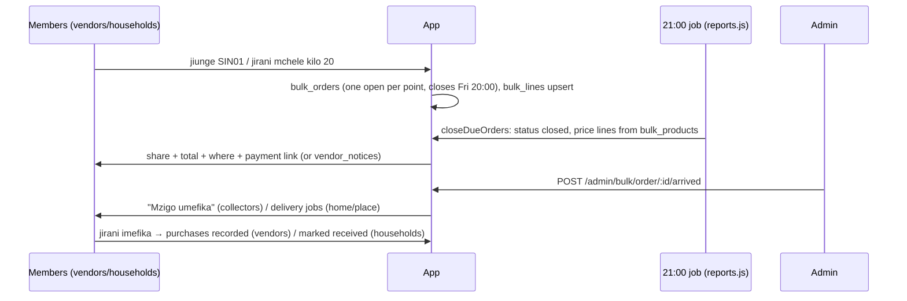

# Mkoba

**Business bookkeeping, shop orders, bulk buying and credit records for Tanzanian micro-vendors — on WhatsApp.**


-339933?logo=node.js&logoColor=white)


| | |
|---|---|
| **Status** | Pre-launch. Core bookkeeping is built and unit-tested; roadmap features 1–12 are built and simulated, but not yet verified against the real Selcom, Google, Africa's Talking or Meta template services. `TODO: Verify` which release is running in production. |
| **Version** | `1.0.0` as declared in `package.json` (npm default; no release tags are defined in the repository). `TODO: Verify` |
| **Public URL** | `https://mkoba.digital` (`PUBLIC_URL` default) |
| **License** | `TODO: Define project license.` (`package.json` carries the npm default `ISC`; no `LICENSE` file exists.) |

> **This README is the single source of truth** for the application until it is split into a `docs/` tree (see [Documentation Roadmap](#58-documentation-roadmap)). Every statement here was checked against the source code. Anything that could not be confirmed from the repository is marked `TODO: Verify`.

---

## Executive Summary

Mkoba is a Node.js/Express server with a PostgreSQL database. Its main user interface is **WhatsApp**: a vendor sends ordinary messages such as `nimeuza chips 5000` ("I sold chips for 5,000") to one WhatsApp Business number, and Mkoba records the sale, keeps totals, debts and stock, and replies in Swahili or English.

Around that core, the same server provides:

- a **shop** (catalog and customer orders on WhatsApp and the web),
- **bulk buying** for groups of vendors and households at collection points,
- **boda (motorbike) delivery** jobs for riders on WhatsApp,
- **mobile-money payments** through Selcom,
- a **credit score**, shareable **business statements** and a **lender portal**,
- **voice-note** transcription (Google Speech-to-Text), **USSD** (Africa's Talking) for basic phones, a read-only **web dashboard** and an offline-capable **Lite App (PWA)**,
- an **admin** web console.

It runs as one Express application (PM2 cluster of 2 instances) behind nginx on a single VPS, deployed by GitHub Actions on every push to `main`.

---

## 1. Project Overview

| Item | Value |
|---|---|
| **Application name** | Mkoba (repository folder and server path: `mkobalabs`; PM2 app name: `mkoba-app`) |
| **Short description** | WhatsApp bookkeeping and business services for micro-vendors in Tanzania. |
| **Detailed description** | Vendors keep sales, purchases, expenses, debts and stock by chatting in Swahili or English. The server parses free text (including Swahili number words and slang), stores records, sends evening summaries, and offers optional services: customer receipts and loyalty points, an online shop with orders, weekly group bulk buying, rider delivery, mobile-money collection, a credit score and lender access with the vendor's consent. |
| **Problem solved** | Micro-vendors rarely keep written books, so they cannot see their profit, chase debts, plan stock, or prove their business to a lender. Apps with forms are a barrier; WhatsApp is already on their phones. |
| **Target users** | Market and street vendors (food, shops, vegetables, clothes); their customers; boda riders; households buying in bulk; lenders/SACCOs; the Mkoba operator (admin). |
| **Primary use cases** | Record a sale/purchase/expense by message or voice; see today's or this month's profit; track who owes whom; know when stock runs low; give a customer a receipt; take orders; buy wholesale with neighbours; get a delivery; collect payment by phone; show a lender 6 months of figures. |
| **Core value proposition** | Bookkeeping with no new app, no forms and no training: write as you speak, in Swahili. |
| **Project status** | Pre-launch (see header). |
| **Current version** | `1.0.0` (`package.json`). `TODO: Verify` |
| **License** | `TODO: Define project license.` |
| **Repository** | GitHub (deployment workflow at `.github/workflows/deploy.yml`, branch `main`). Repository URL: `TODO: Verify`. |

---

## 2. Table of Contents

- [Executive Summary](#executive-summary)
- [1. Project Overview](#1-project-overview)
- [3. Product Overview](#3-product-overview)
- [4. Features](#4-features)
- [5. User Roles and Permissions](#5-user-roles-and-permissions)
- [6. System Architecture](#6-system-architecture)
- [7. Technology Stack](#7-technology-stack)
- [8. Repository Structure](#8-repository-structure)
- [9. Architecture and Design Principles](#9-architecture-and-design-principles)
- [10. Application Data Flow](#10-application-data-flow)
- [11. Database Documentation](#11-database-documentation)
- [12. API Documentation](#12-api-documentation)
- [13. API Conventions](#13-api-conventions)
- [14. Authentication](#14-authentication)
- [15. Authorization](#15-authorization)
- [16. Configuration](#16-configuration)
- [17. Installation](#17-installation)
- [18. Local Development](#18-local-development)
- [19. Docker](#19-docker)
- [20. Database Setup and Migrations](#20-database-setup-and-migrations)
- [21. Testing](#21-testing)
- [22. Code Quality](#22-code-quality)
- [23. Development Workflow](#23-development-workflow)
- [24. Git and Versioning](#24-git-and-versioning)
- [25. CI/CD](#25-cicd)
- [26. Deployment](#26-deployment)
- [27. Production Operations](#27-production-operations)
- [28. Monitoring and Observability](#28-monitoring-and-observability)
- [29. Logging](#29-logging)
- [30. Security](#30-security)
- [31. Privacy and Data Protection](#31-privacy-and-data-protection)
- [32. Error Handling](#32-error-handling)
- [33. Business Logic and Rules](#33-business-logic-and-rules)
- [34. Integrations](#34-integrations)
- [35. Background Jobs and Scheduled Tasks](#35-background-jobs-and-scheduled-tasks)
- [36. Notifications](#36-notifications)
- [37. File and Media Storage](#37-file-and-media-storage)
- [38. Caching](#38-caching)
- [39. Performance](#39-performance)
- [40. Scalability](#40-scalability)
- [41. Disaster Recovery](#41-disaster-recovery)
- [42. Troubleshooting](#42-troubleshooting)
- [43. Health Checks](#43-health-checks)
- [44. API Examples](#44-api-examples)
- [45. Frontend Documentation](#45-frontend-documentation)
- [46. Backend Documentation](#46-backend-documentation)
- [47. Environment Matrix](#47-environment-matrix)
- [48. System Requirements](#48-system-requirements)
- [49. Known Limitations](#49-known-limitations)
- [50. Roadmap](#50-roadmap)
- [51. Frequently Asked Questions](#51-frequently-asked-questions)
- [52. Glossary](#52-glossary)
- [53. Contribution Guide](#53-contribution-guide)
- [54. Security Reporting](#54-security-reporting)
- [55. Support](#55-support)
- [56. License](#56-license)
- [57. Changelog](#57-changelog)
- [58. Documentation Roadmap](#58-documentation-roadmap)
- [59. TODO / Documentation Gaps](#59-todo--documentation-gaps)

---

## 3. Product Overview

### What the product does

Mkoba turns WhatsApp messages into business records and services. Every person (vendor, customer, rider, household) talks to **one WhatsApp Business number**. The server decides who is writing and what they want, acts on the database, and replies on WhatsApp. A few things happen on web pages instead: the vendor dashboard and Lite App, the public shop and payment pages, the lender portal, and the admin console.

### Why it exists

Micro-vendors need books to see profit, manage debts and stock, and qualify for credit — but forms and dedicated apps are a barrier. Mkoba meets them where they already are (WhatsApp, plain Swahili, voice notes, USSD on basic phones).

### Main workflows

```text
Vendor:     sign up (consent) -> record daily -> see summaries / evening report
            -> optional: stock, receipts & points, shop & orders, bulk buying,
               score & statement, lenders, payments, dashboard / Lite App / USSD
Customer:   duka <code> -> pick items -> tuma -> (pay) -> receives order (+ receipt, points)
Rider:      boda -> admin approves -> kazi / chukua <id> -> nimechukua -> nimefikisha
Household:  nyumbani -> consent -> join group -> choose where to receive -> weekly bulk order
Lender:     admin creates account -> portal login -> request access by phone -> vendor allows -> view statement
Admin:      monitor, price list, collection points, riders, lenders, Goods arrived, payouts
```

### Major user types

Vendor, customer, boda rider, household, lender, admin. See [User Roles and Permissions](#5-user-roles-and-permissions).

### Main system capabilities

Free-text and voice record parsing (Swahili/English, number words, slang, typos); confidence-based confirmation; summaries and scheduled reports; debts with forwardable reminders; derived stock with alerts; receipts and loyalty points; catalog and orders; weekly group bulk orders; delivery jobs with distance-based fees; Selcom checkout and wallet push; credit score; expiring statement links; lender consent and audit; USSD menu; PWA with offline queue; consent and full data deletion; admin console.

### Business/domain concepts

| Concept | Meaning in Mkoba |
|---|---|
| Record / entry | One row in `transactions`: sale, purchase, expense, a debt event, or a transfer awaiting classification. |
| Pending record | Saved with `status = 'pending'`; counts only after the vendor replies `NDIO`/`YES` (within 1 hour). |
| Message group | All records created from one incoming message share a `message_id`; `futa` (undo) deletes the whole group. |
| Debt event | `credit_given`, `credit_received`, `repayment_received`, `repayment_made` with a `counterparty` name. |
| Stock | Not stored as a balance; computed from the last count plus later purchases minus sales that carry a quantity. |
| Shop code | 4–6 digit number identifying a vendor's shop (`duka 4108`, `/k/4108`). |
| Group = collection point | A row in `collection_points`. Members order together weekly; goods arrive at the point. |
| Household | A `vendors` row with `kind = 'household'`; uses only bulk buying. |
| 24-hour window | WhatsApp rule: free-form messages only within 24 h of the person's last message (code uses 23 h). |
| Notice | A message kept in `vendor_notices` because it could not be sent; delivered with the vendor's next reply. |

### Important terminology

Swahili command words used throughout this document: `nimeuza` (I sold), `nimenunua` (I bought), `nimelipa` (I paid — expense), `nimemlipa` (I paid him/her — debt repayment), `anadaiwa` (owes [me]), `ananidai` (I owe [him/her]), `futa` (delete), `rekebisha` (correct), `NDIO`/`HAPANA` (yes/no), `NAKUBALI` (I agree), `stoo` (stock), `risiti` (receipt), `pointi` (points), `bidhaa` (items), `oda` (order), `kubali`/`kataa`/`maliza` (accept/reject/complete), `jirani` (neighbour — bulk order), `vikundi`/`kikundi` (groups/group), `jiunge` (join), `pokea` (receive), `alama` (score), `taarifa ya biashara` (business statement), `wakopeshaji` (lenders), `ruhusu` (allow), `LIPA` (pay), `dashibodi` (dashboard), `boda` (motorbike taxi), `kazi` (jobs), `chukua` (take), `nimefikisha` (delivered), `nyumbani` (home/household), `msaada` (help). Full list in the [Glossary](#52-glossary).

---

## 4. Features

Status legend: **Implemented** = in code and covered by unit tests or simulated end-to-end in development; **Implemented, unverified** = in code but not yet tested against the real external provider; **Partial** = works with stated gaps; **Planned** = not built.

### 4.1 Feature summary

| # | Feature | Status | Main modules |
|---|---|---|---|
| F1 | Sign-up and consent | Implemented | `onboarding.js`, `privacy.js`, `webhook.js` |
| F2 | Recording sales, purchases, expenses | Implemented | `parser.js`, `ledger.js` |
| F3 | Undo and correct | Implemented | `corrections.js` |
| F4 | Summaries and help | Implemented | `summary.js` |
| F5 | Evening and weekly reports | Implemented (template unverified) | `reports.js` |
| F6 | Debts and reminders | Implemented | `debts.js` |
| F7 | Mobile-money SMS import | Partial (Airtel Money TZ outgoing only) | `mobilemoney.js` |
| F8 | Stock | Implemented | `stock.js` |
| F9 | Receipts and loyalty points | Implemented | `loyalty.js` |
| F10 | Shop catalog and orders (WhatsApp + web) | Implemented | `catalog.js` |
| F11 | Bulk buying groups (Jirani) | Implemented | `bulk.js` |
| F12 | Households | Implemented | `household.js` |
| F13 | Credit score | Implemented | `score.js` |
| F14 | Business statement links | Implemented | `statement.js` |
| F15 | Lender portal and consent | Implemented | `lender.js` |
| F16 | Boda delivery | Implemented | `delivery.js` |
| F17 | Payments (Selcom) | Implemented, unverified | `payments.js`, `selcom.js` |
| F18 | Voice notes (Google STT) | Implemented, unverified | `voice.js` |
| F19 | USSD (Africa's Talking) | Implemented, unverified | `ussd.js` |
| F20 | Vendor web dashboard | Implemented | `dashboard.js` |
| F21 | Lite App (PWA) | Implemented | `liteapp.js`, `public/app/*` |
| F22 | Language (Swahili/English) | Implemented | `i18n.js` |
| F23 | Privacy notice and data deletion | Implemented | `privacy.js`, `privacy-page.js` |
| F24 | Admin console | Implemented | `admin.js` + admin routers in `bulk.js`, `lender.js`, `delivery.js`, `payments.js` |
| F25 | Parser feedback review | Implemented | `feedback.js`, `review.js` |
| F26 | Health check | Implemented | `app.js`, `whatsapp.js` |

### 4.2 Feature details

Each block lists: what it does · who uses it · key rules · endpoints · tables · dependencies. Full rules are in [Business Logic and Rules](#33-business-logic-and-rules).

#### F1. Sign-up and consent
- **What:** A new number gets a welcome with a data notice; nothing is recorded until the person agrees. Then Mkoba asks for a name and business type.
- **Who:** New vendors (WhatsApp, or USSD option `1. Nakubali`).
- **Rules:** First message is never acted on. Consent words: `nakubali`, `ninakubali`, `kubali`, `nakubaliana`, `i agree`, `agree`, `i accept`, `accept`, `ndio`, `ndiyo`, `yes`. `ruka`/`skip` ends sign-up. Name: no digits, ≤ 4 words, ≤ 40 chars, not only greetings, not a command.
- **Endpoints:** `POST /webhook`, `POST /ussd/:token`.
- **Tables:** `vendors` (`consent_at`, `onboarding_step`, `name`, `business_type`).
- **Dependencies:** WhatsApp Cloud API.

#### F2. Recording sales, purchases, expenses
- **What:** Parses free text into one or more records with kind, amount, item, quantity and unit.
- **Who:** Vendors (WhatsApp text or voice; Lite App form; USSD menu).
- **Rules:** Kind from action word; amount from digits, `5k`, `15,000`, `1.5m`, `20000/=`, Swahili number words (`elfu kumi na tano`), slang (`buku`, `ngiri`, `thao`, `jero`); typo-tolerant verbs; confidence ≥ 0.8 saves, 0.6–0.8 asks NDIO/HAPANA, < 0.6 "not understood" and logged for review; price memory for small bare numbers (< 100); voice records always need NDIO.
- **Endpoints:** `POST /webhook`, `POST /d/api/records`, `POST /ussd/:token`.
- **Tables:** `transactions`, `messages_log`, `parse_feedback`.

#### F3. Undo and correct
- **What:** `futa`/`undo` deletes all confirmed records from the newest recorded message; `rekebisha 6500`/`correct 6500` changes the newest single record's amount.
- **Who:** Vendors. (Lite App can delete any recent record; USSD option 8 deletes the newest single record.)
- **Rules:** Soft delete (`deleted_at`). Correct refuses multi-record messages. Corrections are logged to `parse_feedback`.
- **Tables:** `transactions`, `parse_feedback`.

#### F4. Summaries and help
- **What:** Totals for `leo`/`today`, `jana`/`yesterday`, `wiki`/`week` (from Monday), `mwezi`/`month`, `salio`/`balance` (all time); best seller, biggest cost and previous-period comparison. `msaada`/`help` lists commands.
- **Rules:** Africa/Dar_es_Salaam time; only confirmed, undeleted sale/purchase/expense rows; profit = sales − purchases − expenses.
- **Tables:** `transactions`.

#### F5. Evening and weekly reports
- **What:** At 21:00 (server timer) each consenting vendor with reports on and at least one record in the period gets today's summary (Mon–Sat) or this week's (Sunday, plus top 5 debtors). Low stock is appended.
- **Rules:** In-window vendors get full text; others get the approved template `REPORT_TEMPLATE` (default `mkoba_muhtasari`). `report_log` prevents duplicate sends. `ACHA RIPOTI`/`STOP REPORTS` and `ANZA RIPOTI`/`START REPORTS` toggle `vendors.daily_report`.
- **Tables:** `report_log`, `vendors`, `transactions`.
- **Dependencies:** systemd timer on the server (`TODO: Verify` unit file; not in repository), WhatsApp template approval.

#### F6. Debts and reminders
- **What:** Four debt kinds by message; balances per person; ready-to-forward reminder text.
- **Rules:** Saved immediately (confidence 0.9, no NDIO). Names: one word, or a title (`mama`, `baba`, `bi`, `bw`, `bwana`, `kaka`, `dada`, `mzee`, `ndugu`, `shangazi`, `mjomba`, `mr`, `mrs`) + one word. Debts do not affect profit.
- **Tables:** `transactions` (`counterparty`).

#### F7. Mobile-money SMS import — Partial
- **What:** A pasted confirmation SMS is recognised and recorded as purchase/expense (pending NDIO), or as a person transfer the vendor classifies (`1` purchase, `2` expense, `3` personal).
- **Rules:** Duplicate TIDs refused (`transactions_vendor_external_ref_uniq`); agent deposits, card SMS, Kenyan-shilling SMS are ignored with a reason.
- **Gap:** Only Airtel Money Tanzania outgoing formats. Incoming payments and other providers are not supported.
- **Tables:** `transactions` (`external_ref`, type `transfer_out` until classified).

#### F8. Stock
- **What:** `stoo`/`stock` lists stock; `stoo mchele kilo 20` sets a count; `stoo mchele chini ya 5` / `below 5` sets an alert; `chini ya auto` reverts to automatic.
- **Rules:** Stock = last count + purchases − sales (with quantity) after the count. Automatic alert ≈ 2 days of sales (needs ≥ 3 sales with quantity in 14 days). Alert fires on crossing. Units: kg, l, g, pieces.
- **Tables:** `stock_items`, `transactions`.

#### F9. Receipts and loyalty points
- **What:** `risiti <phone> <items>` saves sales and produces a numbered receipt (R-0001…) for the vendor to forward; points 1 per TSh 1,000; `pointi`, `pointi <phone>`, `tumia pointi <phone> <n>`.
- **Tables:** `receipts`, `point_redemptions`, `transactions`.

#### F10. Shop catalog and orders
- **What:** Vendor catalog (`bidhaa …`), customer ordering on WhatsApp (`duka <code>`, 2-hour session) and web (`/k/:code`), order handling (`kubali`/`kataa`/`maliza oda N`), payment link and delivery job on accept, receipt on complete.
- **Rules:** Quantity ≤ 99 per item; web orders: 5 per 10 minutes per IP, honeypot field `website`.
- **Endpoints:** `GET/POST /k/:code`, `POST /webhook`, `POST /d/api/orders/:n/:action`.
- **Tables:** `catalog_items`, `orders`, `order_items`, `customer_sessions`, `vendors.shop_code`.

#### F11. Bulk buying groups (Jirani)
- **What:** Collection points as groups; join by code/name/area or nearest by location (≤ 3 km); weekly group order (`jirani …`); closes Friday 20:00; priced from the admin price list at close; member notices with payment link; admin "Goods arrived"; `jirani imefika` records the purchase.
- **Endpoints:** `POST /webhook`, `/admin/bulk/*`.
- **Tables:** `collection_points`, `bulk_products`, `bulk_orders`, `bulk_lines`, `vendor_notices`, `vendors` (`group_id`, `lat`, `lng`, `bulk_hint_at`, `delivery_mode`, `delivery_address`).

#### F12. Households
- **What:** `nyumbani` registers a household that only uses bulk buying, must choose where to receive, and keeps no records.
- **Tables:** `vendors` (`kind = 'household'`).

#### F13. Credit score
- **What:** 0–100 score from 90 days of records in six parts (30/25/15/15/10/5), grade A–E, tips. Daily snapshots.
- **Rules:** Needs ≥ 14 days with records and ≥ 30 days since first record.
- **Tables:** `credit_scores`, `transactions`, `receipts`.

#### F14. Business statement
- **What:** `taarifa ya biashara`/`statement` creates a 30-day secret link to a 6-month statement page; creating one revokes earlier links; `funga taarifa`/`close statement` revokes all.
- **Endpoints:** `GET /s/:token`.
- **Tables:** `statement_links`.

#### F15. Lender portal and consent
- **What:** Admin-created lender accounts; lender requests access by phone; vendor allows/declines/revokes; portal shows permitted vendors' statements and score history; all events and views logged.
- **Endpoints:** `/l/*`, `/admin/lenders/*`.
- **Tables:** `lenders`, `lender_sessions`, `lender_consents`, `consent_events`, `lender_views`, `credit_scores`.

#### F16. Boda delivery
- **What:** Rider registration (admin or `boda`), job creation from accepted delivery orders and bulk shares, distance-based fee, job broadcast to riders within 5 km, rider commands, status notices.
- **Endpoints:** `POST /webhook`, `/admin/riders/*`.
- **Tables:** `riders`, `deliveries`, `delivery_settings`, `orders` (`drop_lat`, `drop_lng`), `bulk_orders.arrived_at`.

#### F17. Payments (Selcom) — Implemented, unverified
- **What:** Selcom checkout orders for shop orders, bulk shares and delivery fees; short links `/pay/<ref>`; `LIPA` wallet push (PIN prompt); status always re-queried from Selcom; admin payout ledger.
- **Rules:** Off unless `SELCOM_VENDOR`, `SELCOM_API_KEY`, `SELCOM_API_SECRET` are set (or `DRY_RUN=1`). Pending payments expire after 7 days.
- **Endpoints:** `GET /pay/:ref`, `GET /pay/:ref/done`, `POST /pay/selcom/webhook`, `/admin/payments/*`.
- **Tables:** `payments`, `payouts`, `orders.paid_at`.

#### F18. Voice notes — Implemented, unverified
- **What:** WhatsApp voice notes (Ogg/Opus, ≤ 60 s) are transcribed (sw-TZ or en-US) and handled as typed text; the transcript is echoed first.
- **Rules:** Only for consenting vendors/households, riders, customers in a session. Records from voice always wait for NDIO.
- **Dependencies:** Google Cloud Speech-to-Text v1; `GOOGLE_STT_CREDENTIALS` or `GOOGLE_STT_API_KEY`.

#### F19. USSD — Implemented, unverified
- **What:** Menu for basic phones: record sale/purchase/expense, today/week summary, debts, stock, delete last record; sign-up with consent and name.
- **Endpoints:** `POST /ussd/:token`.
- **Dependencies:** Africa's Talking USSD shortcode (`TODO: Verify` — not yet leased).

#### F20. Vendor web dashboard
- **What:** Read-only page with totals (today/week/month), 14-day profit chart, recent records, debts, stock, score, Lite App button. Login by one-time WhatsApp link.
- **Endpoints:** `GET /d`, `GET /d/login`, `POST /d/login`, `POST /d/logout`.
- **Tables:** `login_tokens`, `sessions`.

#### F21. Lite App (PWA)
- **What:** Installable app at `/d/app` with Home, Records, Stock, Orders, Debts tabs; offline queue with idempotent replay.
- **Endpoints:** `/d/app/*`, `/d/api/*`.
- **Tables:** `transactions.client_ref`, `messages_log` (channel `app`).

#### F22. Language
- **What:** `english`/`kiswahili` switch; automatic switch only on clearly one-language messages; pasted SMS never switches.
- **Tables:** `vendors.language` (`sw`|`en`).

#### F23. Privacy and data deletion
- **What:** Privacy pages `/faragha`, `/privacy`; `FUTA DATA` then `FUTA KABISA` within 10 minutes deletes the vendor and linked data in one transaction.
- **Tables:** all vendor-linked tables (see [Privacy](#31-privacy-and-data-protection)).

#### F24. Admin console
- **What:** `/admin` overview, `/admin/bulk`, `/admin/riders`, `/admin/lenders`, `/admin/payments`.
- **Auth:** HTTP Basic, user `admin`, password `ADMIN_PASSWORD`.

#### F25. Parser feedback review
- **What:** Messages not understood, rejected (HAPANA) or corrected are stored in `parse_feedback`; `node review.js` lists them with what the parser does now; `--done` marks them reviewed. The admin page shows the latest 15 unreviewed.

#### F26. Health check
- **What:** `GET /health` returns 200 when the database answers within 3 s and WhatsApp sending is healthy; 503 otherwise.

### 4.3 Not implemented (do not assume these exist)

Automatic payouts or refunds; wholesaler accounts; automatic PDF receipts to customers; incoming mobile-money SMS; individual admin accounts or MFA; email or SMS notifications; file uploads; caching layer; Docker images; staging environment configuration in the repository.

---

## 5. User Roles and Permissions

Mkoba has **no RBAC table, no scopes and no claims**. A role is determined by **how the person reaches the system**:
- **WhatsApp/USSD:** by phone number and which table the number is in.
- **Web:** by which session cookie or credential they hold.

### 5.1 Roles

| Role | Identified by | Channel(s) | Stored in |
|---|---|---|---|
| **Vendor** | WhatsApp phone number with `vendors.kind = 'vendor'` | WhatsApp, USSD, dashboard, Lite App | `vendors` |
| **Household** | Phone number with `vendors.kind = 'household'` | WhatsApp | `vendors` |
| **Customer** | Phone number in an open `customer_sessions` row, or on `orders`/`receipts`; never registered | WhatsApp, web shop `/k`, payment pages `/pay` | `customer_sessions`, `orders`, `receipts` |
| **Boda rider** | Phone number in `riders` | WhatsApp | `riders` |
| **Lender** | Lender code + password; session cookie `mk_lender` (path `/l`) | Web portal `/l` | `lenders`, `lender_sessions` |
| **Admin** | HTTP Basic credentials (user `admin`, `ADMIN_PASSWORD`) | Web `/admin` | none (environment variable) |
| **Anonymous public** | — | `/`, `/health`, `/faragha`, `/privacy`, `/k/:code`, `/s/:token`, `/pay/:ref` | — |
| **Machine callers** | Meta signature; USSD URL secret; Selcom order reference | `/webhook`, `/ussd/:token`, `/pay/selcom/webhook` | — |

There is **no role hierarchy**: an admin cannot act as a vendor in WhatsApp, and a phone number holds exactly one of vendor / household / rider at a time (see [Known Limitations](#49-known-limitations)).

### 5.2 Permission matrix

✅ = allowed · ❌ = not allowed · ◐ = only for own data / with conditions

| Capability | Vendor | Household | Customer | Rider | Lender | Admin |
|---|---|---|---|---|---|---|
| Record sales/purchases/expenses, debts | ◐ own | ❌ | ❌ | ❌ | ❌ | ❌ |
| See own summaries, stock, debts, score | ◐ own | ❌ | ❌ | ❌ | ❌ | ◐ aggregate on `/admin` |
| Manage own catalog; accept/reject/complete own orders | ◐ own | ❌ | ❌ | ❌ | ❌ | ❌ |
| Place shop orders | ✅ (as customer of another shop) | ❌ | ✅ | ❌ | ❌ | ❌ |
| Join groups; add to weekly bulk order | ✅ | ✅ | ❌ | ❌ | ❌ | ❌ |
| Create collection points | ✅ (`unda kikundi`) | ✅ | ❌ | ❌ | ❌ | ✅ |
| Set wholesale prices; mark goods arrived | ❌ | ❌ | ❌ | ❌ | ❌ | ✅ |
| Take and update delivery jobs | ❌ | ❌ | ❌ | ◐ when `status='active'`; own jobs only | ❌ | ❌ |
| Approve / switch off riders; set fee settings | ❌ | ❌ | ❌ | ❌ | ❌ | ✅ |
| Create statement link; allow/revoke lenders | ◐ own | ❌ | ❌ | ❌ | ❌ | ❌ |
| View a vendor's statement and score | ◐ own (via link) | ❌ | ❌ | ❌ | ◐ only with `lender_consents.status='granted'` | ❌ (no statement view in admin) |
| Request access to a vendor | ❌ | ❌ | ❌ | ❌ | ✅ (30/day) | ❌ |
| Create lenders, reset lender passwords | ❌ | ❌ | ❌ | ❌ | ❌ | ✅ |
| Pay by phone (`LIPA`, `/pay/:ref`) | ◐ own payments | ◐ own | ◐ own | ❌ | ❌ | ❌ |
| See payments, record payouts | ❌ | ❌ | ❌ | ❌ | ❌ | ✅ |
| Delete all own data | ✅ `FUTA DATA` | ✅ | ❌ (no command) | ✅ `futa data` | ❌ | ❌ |

### 5.3 Protected resources

| Resource | Protection |
|---|---|
| `/webhook` (POST) | HMAC-SHA256 signature (`x-hub-signature-256`) with `META_APP_SECRET`, timing-safe compare |
| `/ussd/:token` | Path secret `USSD_TOKEN`, length check + timing-safe compare; wrong token → 404 |
| `/d`, `/d/api/*` | `mk_sess` cookie → `sessions` row (SHA-256 of cookie), not expired; `/d/api` also requires `vendors.kind = 'vendor'` and same-origin on writes |
| `/l/*` (except `/l/login`) | `mk_lender` cookie → `lender_sessions`; lender `active`; per-vendor consent check on `/l/v/:id` |
| `/s/:token` | Unguessable token (32 random bytes); only SHA-256 stored; not revoked, not expired |
| `/admin/*` | HTTP Basic (`admin` / `ADMIN_PASSWORD`); 404 when password unset; sub-routers require same-origin POSTs |
| `/pay/:ref` | Reference format `MKB[A-Z0-9]{4,20}`; shows only amount and status |

---

## 6. System Architecture

### 6.1 Overview



### 6.2 Components

| Component | What it is | Where |
|---|---|---|
| **Frontend** | Server-rendered HTML pages (no framework, inline CSS from `html.js`) for dashboard, admin, shop, statement, lender portal, payment, privacy. One client-side app: the Lite App PWA (`public/app/`, vanilla JS, service worker). | `dashboard.js`, `admin.js`, `catalog.js`, `statement.js`, `lender.js`, `payments.js`, `privacy-page.js`, `liteapp.js`, `public/app/` |
| **Backend** | Node.js + Express 5, single process type, started by `index.js`, run by PM2 in cluster mode (2 instances). | `index.js`, `app.js`, feature modules |
| **Database** | PostgreSQL via `pg` connection pool, plain SQL (no ORM). | `db.js`, `migrations/` |
| **Background work** | No queue/worker process. Scheduled batch `node reports.js` (21:00) does reports, bulk-order closing, score snapshots and payment re-checks. Webhook work runs in the request process after the 200 response. | `reports.js` |
| **Caching** | None server-side, apart from in-memory Google access-token cache and in-memory rate-limit maps. The PWA service worker caches app files and last API responses on the phone. | `voice.js`, `public/app/sw.js` |
| **Storage** | Database only. No file uploads; voice audio is processed in memory and not stored. | — |
| **Messaging** | WhatsApp Cloud API (outbound HTTP); undeliverable messages kept in `vendor_notices`. No message broker. | `whatsapp.js`, `bulk.js` |
| **Authentication services** | Built in (one-time links, cookies, scrypt, HTTP Basic). No external identity provider. | `dashboard.js`, `lender.js`, `admin.js` |
| **Third-party integrations** | Meta WhatsApp Cloud API, Selcom Checkout API, Google Cloud Speech-to-Text, Africa's Talking USSD. | see [Integrations](#34-integrations) |
| **Infrastructure** | One VPS: nginx reverse proxy → app on `127.0.0.1:3000`; PostgreSQL on the same host (`TODO: Verify`); systemd timer; PM2. | Server; only `ecosystem.config.js` and the workflow are in the repository |
| **Deployment** | GitHub Actions on push to `main`: syntax check, unit tests, SSH to VPS, `git pull`, `npm install --omit=dev`, `node migrate.js`, `pm2 startOrReload`. | `.github/workflows/deploy.yml` |

---

## 7. Technology Stack

| Layer | Technology | Version | Purpose |
|---|---|---|---|
| Runtime | Node.js | 24 in CI (`actions/setup-node`); production `TODO: Verify` | Server runtime. Code needs ≥ 18.2 (`server.closeIdleConnections`). |
| Web framework | Express | 5.3.0 in the development workspace (`^5.3.0`) | HTTP routing. Express 5 path syntax applies (no `'*'`, no inline regex params). |
| Database | PostgreSQL | `TODO: Verify` production version; ≥ 14 required (`CREATE OR REPLACE TRIGGER`) | System of record. |
| DB driver | `pg` (node-postgres) | 8.23.1 (workspace) | Connection pool, parameterised SQL. |
| HTTP client | `axios` | 1.20.0 (workspace) | WhatsApp, Selcom, Google calls. |
| Config | `dotenv` | 17.4.2 (workspace) | Loads `.env`. |
| Process manager | PM2 | `TODO: Verify` | Cluster mode, zero-downtime reload (`ecosystem.config.js`). |
| Reverse proxy | nginx | `TODO: Verify` | TLS termination, proxy to `127.0.0.1:3000`. Config not in repository. |
| Scheduler | systemd timer | — | Runs `node reports.js` at 21:00 Tanzania time. Unit files not in repository (`TODO: Verify`). |
| CI/CD | GitHub Actions | `actions/checkout@v4`, `actions/setup-node@v4`, `appleboy/ssh-action@v1.0.3` | Test and deploy on push to `main`. |
| Tests | Plain Node script | — | `node test.js` (299 assertions, no framework, no database). |
| Frontend | Server-rendered HTML + vanilla JS PWA | — | No build step, no bundler. |
| Messaging | WhatsApp Cloud API | Graph API v20.0 | Main user channel. |
| Payments | Selcom Checkout API | `/v1/` | Mobile-money collection. |
| Speech | Google Cloud Speech-to-Text | v1 `speech:recognize` | Voice notes. |
| USSD | Africa's Talking | — | Basic-phone menu. |
| Logging | Custom JSON logger (`log.js`) to stdout/stderr | — | Collected by PM2 logs. |
| Package manager | npm (`package-lock.json`) | — | `npm ci` in CI, `npm install --omit=dev` on server. |
| Docker | Not used | — | — |

> `package.json` and `package-lock.json` in the development workspace also list `playwright`, which the application does **not** require. The production `package.json` is maintained on the server/repository and should list only `express`, `pg`, `axios`, `dotenv`. `TODO: Verify` the committed `package.json`.

---

## 8. Repository Structure

```text
mkobalabs/
├── .github/
│   └── workflows/
│       └── deploy.yml          # CI: syntax check + unit tests, then SSH deploy to the VPS
├── migrations/
│   ├── 001_initial.sql         # base schema (pg_dump of the live DB) — NOT in the delivered file set; kept by the owner
│   ├── 002_add_indexes.sql … 018_lite_app.sql   # incremental schema changes, applied by migrate.js
├── public/
│   └── app/                    # Lite App (PWA) static files: app.js, app.css, sw.js, icons
├── index.js                    # entry point: dotenv, listen, PM2 ready signal, graceful shutdown
├── app.js                      # Express app: middleware, signature check, health, route mounting, error page
├── webhook.js                  # WhatsApp inbound: identify sender, route text to feature handlers
├── whatsapp.js                 # WhatsApp Cloud API client + send-health tracking
├── db.js                       # pg Pool
├── log.js                      # JSON logger, phone masking
├── migrate.js                  # migration runner (apply / --status / --baseline)
├── review.js                   # CLI: review parser feedback
├── reports.js                  # 21:00 batch (also a module): reports, bulk close, score snapshots, payment checks
├── ecosystem.config.js         # PM2 configuration
├── html.js                     # shared HTML layout, escaping, security headers
├── i18n.js                     # Swahili/English strings, language detection
├── format.js                   # TSh formatting, record descriptions
├── parser.js                   # free text -> records (kinds, amounts, number words, units, typos)
├── ledger.js                   # save records, confidence rules, NDIO/HAPANA, price memory
├── corrections.js              # futa (undo) / rekebisha (correct)
├── summary.js                  # period summaries, help
├── debts.js                    # debt parsing, balances, reminders
├── mobilemoney.js              # pasted mobile-money SMS import
├── stock.js                    # stock calculation, counts, alerts
├── loyalty.js                  # receipts and points
├── catalog.js                  # vendor catalog, WhatsApp and web ordering, order handling
├── bulk.js                     # groups, weekly bulk orders, notices, /admin/bulk
├── household.js                # household registration and routing
├── score.js                    # credit score
├── statement.js                # business statement links and page (/s)
├── lender.js                   # lender commands, portal (/l), /admin/lenders
├── delivery.js                 # riders, delivery jobs and fees, /admin/riders
├── selcom.js                   # Selcom API client (signing, endpoints)
├── payments.js                 # payments, /pay pages, Selcom webhook, /admin/payments
├── voice.js                    # voice-note download + Google STT
├── ussd.js                     # Africa's Talking USSD menu
├── dashboard.js                # vendor dashboard (/d), login links, sessions
├── liteapp.js                  # Lite App shell, manifest, service worker, JSON API (/d/app, /d/api)
├── onboarding.js               # vendor sign-up questions
├── privacy.js                  # consent gate, data deletion
├── privacy-page.js             # /faragha and /privacy pages
├── admin.js                    # /admin overview + mounting of admin sub-pages
├── feedback.js                 # parse_feedback writer
├── test.js                     # unit tests (no database)
├── .env.example                # all configuration keys, no secrets
├── package.json / package-lock.json
└── FILES.txt                   # file list of the last delivered bundle
```

### Responsibilities and boundaries

- **Transport layer** (`app.js`, `webhook.js`, `ussd.js`, web routers): authenticates the caller, parses input, calls feature handlers, sends replies. Only `webhook.js` decides *which* feature answers a WhatsApp message.
- **Feature modules** (one file per domain): each owns its parse function (`parseX`), its reply builder (`xReply`) and, where relevant, its web/admin router. Modules call each other directly (`require`), e.g. `catalog.js` → `delivery.js` → `payments.js`.
- **Shared infrastructure**: `db.js`, `log.js`, `whatsapp.js`, `html.js`, `i18n.js`, `format.js`.
- **Data access** is inline SQL in each module; there is no repository layer. Multi-step writes use explicit transactions (`BEGIN`/`COMMIT`) with advisory locks where numbering must be gap-free.
- **CLIs** (`migrate.js`, `review.js`, `reports.js`) load `.env` themselves and share the pool.

---

## 9. Architecture and Design Principles

Patterns that actually exist in the code:

| Pattern | Where / how |
|---|---|
| **Modular monolith** | One deployable; one file per business domain. |
| **Command parsing + routing chain** | `webhook.routeText` tries each feature's `parseX(text)` in a fixed order; the first match answers. Order is deliberate (e.g. debts before ledger so `Juma amelipa 2000` is a debt, mobile-money before debts). |
| **Server-side rendering** | Web pages are template strings from `html.page()` with `esc()` escaping. |
| **Plain SQL, no ORM** | Parameterised queries (`$1`, `$2`); computed views (stock, balances, score, points) are SQL aggregates, not stored balances. |
| **Derived state over stored balances** | Debt balances, stock, points and scores are recomputed from `transactions` so deletes and corrections flow through automatically. |
| **Soft delete** | `transactions.deleted_at`; every read filters `deleted_at IS NULL AND status = 'confirmed'`. |
| **Idempotency keys** | `messages_log.wa_message_id` (Meta retries), `transactions(vendor_id, client_ref)` (Lite App), `transactions(vendor_id, external_ref)` (SMS TIDs), `report_log` claim row, `deliveries` one-per-order/share indexes, `bulk_orders` one-open-per-point index. |
| **Acknowledge then process** | `/webhook` returns 200 immediately, then processes; graceful shutdown waits for in-flight work. |
| **Store-and-forward notices** | Messages blocked by the 24-hour window go to `vendor_notices` and are appended to the vendor's next reply. |
| **Never trust callbacks** | Selcom webhook only supplies an order reference; status is fetched from Selcom. |
| **Feature switches by configuration** | Payments, voice, USSD, admin, reports template turn on only when their settings exist. |
| **Bilingual by design** | All user-facing strings in `i18n.js` or per-module `W = { sw, en }` tables. |

Not used: dependency injection containers, CQRS, event sourcing, message queues, repository pattern, frontend framework.

**Key decisions**
- WhatsApp is the primary UI; web pages are secondary and mostly read-only.
- Confidence-based saving: sure → save, unsure → ask, unclear → refuse and log. Voice-derived records always ask.
- Only hashes of login tokens, sessions and statement tokens are stored.
- Households are stored as `vendors` with `kind = 'household'` to reuse groups and bulk orders.
- Money collected by phone goes to one Mkoba Selcom account; payouts are manual for now.

---

## 10. Application Data Flow

### 10.1 Generic request flow (WhatsApp)

```text
Person ─▶ WhatsApp ─▶ Meta ─▶ nginx ─▶ POST /webhook
  └─ validSignature (HMAC, META_APP_SECRET) ──✗──▶ 401
  └─ 200 OK sent immediately
  └─ processWebhook(body)
       ├─ ignore other phone_number_id / log delivery statuses
       ├─ voice note? ─▶ download media ─▶ Google STT ─▶ echo "Nimesikia" ─▶ treat as text
       ├─ who is it?  rider ▸ shop open ▸ customer session ▸ past customer ▸ new household ▸ vendor
       ├─ vendor: upsert row, log message once (wa_message_id), language, consent gate
       ├─ routeText: deletion ▸ consent ▸ onboarding ▸ commands ▸ … ▸ debts ▸ ledger
       ├─ business logic + SQL (transactions where needed)
       └─ reply(s) via Graph API (+ waiting order notices + kept notices)
  └─ on exception: log message_failed, send "Samahani, kuna tatizo la mfumo"
```

### 10.2 Recording a sale



### 10.3 Shop order with delivery and payment



### 10.4 Weekly bulk order



### 10.5 Validation, auth and error handling along the path

| Stage | Behaviour |
|---|---|
| Validation | Each `parseX` returns `null` when the text is not for it; amounts, phones (Tanzanian mobile: `+255`/`255`/`0` followed by `6` or `7` and 8 digits), codes and quantities are validated in handlers; web forms re-render with a message and HTTP 400. |
| Authentication | Per channel (signature, path secret, cookies, Basic). See [Authentication](#14-authentication). |
| Authorization | Ownership is enforced by always scoping SQL by the caller's `vendor_id`/`lender_id`/`rider_id`. |
| Database | Multi-row changes in explicit transactions; unique violations used for idempotency (e.g. `23505` on duplicate SMS). |
| External calls | Timeouts (WhatsApp 15 s, Selcom 20 s, Google 30 s, token 15 s); failures logged and turned into user-facing fallbacks (link instead of PIN prompt, "type instead" for voice). |
| Errors | WhatsApp: generic Swahili/English "system problem" message. Web: plain error page (no internals), HTTP 500. Lite App API: JSON `{error}`. See [Error Handling](#32-error-handling). |

---

## 11. Database Documentation

### 11.1 Technology and conventions

- **PostgreSQL** (≥ 14), schema `public`, accessed with parameterised SQL through `pg`.
- **Keys:** `BIGSERIAL`/`BIGINT` surrogate keys; natural composite keys where they express a rule (e.g. `stock_items (vendor_id, item_key, unit)`).
- **Timestamps:** `TIMESTAMPTZ`, default `now()`. All "day" logic converts to `Africa/Dar_es_Salaam` in SQL.
- **Money:** `amount_tsh`, `price`, `amount`, `total`, `fee` are `NUMERIC` in Tanzanian shillings (TSh). No currency column.
- **Phone numbers:** stored as `255XXXXXXXXX` (no `+`).
- **Soft delete:** only `transactions.deleted_at`. Everything else is hard-deleted (including by full data deletion).
- **Audit fields:** `created_at` on most tables; `updated_at` maintained by trigger on `vendors` and `transactions` (migration 003) and set by code on `stock_items`, `catalog_items`, `orders`, `bulk_products`.
- **Data ownership:** almost every row belongs to one `vendors.id`. Exceptions: `riders`, `lenders`, `collection_points`, `bulk_products`, `delivery_settings`, `payouts`, `customer_sessions` (keyed by customer phone).

> **Base schema (`migrations/001_initial.sql`) is not part of the delivered file set** — it is a `pg_dump` of the live database kept by the owner. The columns of `vendors`, `transactions`, `messages_log`, `report_log` and `parse_feedback` below are **derived from the code that reads and writes them**. Exact types, defaults and constraints: `TODO: Verify` against `001_initial.sql`.

### 11.2 Entity relationship diagram

```mermaid
erDiagram
    vendors ||--o{ transactions : records
    vendors ||--o{ messages_log : sends
    messages_log ||--o{ transactions : "message_id (group)"
    vendors ||--o{ report_log : receives
    vendors ||--o{ parse_feedback : "parser misses"
    vendors ||--o{ login_tokens : "dashboard link"
    vendors ||--o{ sessions : "dashboard session"
    vendors ||--o{ statement_links : shares
    vendors ||--o{ stock_items : counts
    vendors ||--o{ receipts : issues
    vendors ||--o{ point_redemptions : redeems
    vendors ||--o{ catalog_items : sells
    vendors ||--o{ orders : receives
    orders ||--o{ order_items : contains
    vendors ||--o{ customer_sessions : "shop visits"
    collection_points ||--o{ vendors : "group_id"
    collection_points ||--o{ bulk_orders : "weekly order"
    bulk_orders ||--o{ bulk_lines : lines
    vendors ||--o{ bulk_lines : "member share"
    vendors ||--o{ vendor_notices : "kept messages"
    vendors ||--o{ credit_scores : snapshots
    lenders ||--o{ lender_sessions : logs_in
    lenders ||--o{ lender_consents : asks
    vendors ||--o{ lender_consents : decides
    lenders ||--o{ consent_events : audit
    lenders ||--o{ lender_views : views
    riders ||--o{ deliveries : takes
    orders ||--o| deliveries : "order job"
    bulk_orders ||--o{ deliveries : "share jobs"
    orders ||--o{ payments : paid_by
    bulk_orders ||--o{ payments : "share payments"
    deliveries ||--o{ payments : "fee payments"
```



### 11.3 Tables

#### Core (base schema, `001_initial.sql`, columns derived from code)

| Table | Purpose | Important columns | Relationships |
|---|---|---|---|
| `vendors` | Every registered WhatsApp user except riders: vendors **and households**. | `id`, `phone_number` (unique, used in `ON CONFLICT`), `name` (defaults to the phone number until given), `business_type`, `onboarded_via` (`whatsapp`/`ussd`), `onboarding_step` (`ask_name`/`ask_business`/NULL), `daily_report` (bool), `created_at`; added later: `updated_at` (003), `language` `sw`/`en` (005, CHECK), `consent_at`, `deletion_requested_at` (007), `shop_code` UNIQUE (011), `group_id`, `lat`, `lng`, `bulk_hint_at` (012), `kind` `vendor`/`household` (013, CHECK), `delivery_mode` `point`/`home`/`place` (013, CHECK), `delivery_address` | Parent of most tables; `group_id → collection_points.id` |
| `transactions` | Every record: sales, purchases, expenses, debt events, pending transfers. | `id`, `vendor_id`, `message_id` (groups records from one message), `type`, `direction` (`credit`/`debit`/NULL for debts), `amount_tsh`, `raw_input`, `channel`, `parse_confidence`, `status` (`pending`/`confirmed`), `item`, `quantity`, `unit` (`kg`/`l`/`g`/`pcs`/NULL), `counterparty`, `external_ref` (006), `client_ref` (018), `created_at`, `updated_at`, `deleted_at` | `vendor_id → vendors`; `message_id → messages_log.id` (`TODO: Verify` FK) |
| `messages_log` | Raw inbound messages (and USSD/app actions) for audit, dedupe and the 24-hour-window check. | `id`, `wa_message_id` (unique; `ON CONFLICT DO NOTHING`), `vendor_id` (NULL for riders/customers), `phone_number`, `channel` (`whatsapp`/`ussd`/`app`), `direction` (`inbound`/`ussd`/`app`), `raw_payload` (JSON), `created_at` | `vendor_id → vendors` |
| `report_log` | One row per (vendor, period, date) report claimed/sent. | `vendor_id`, `period` (`leo`/`wiki`), `report_date`, `sent_via` (`text`/`template`) | `vendor_id → vendors`; unique on (vendor, period, date) implied by `ON CONFLICT DO NOTHING` (`TODO: Verify`) |
| `parse_feedback` | Parser misses for review. | `id`, `vendor_id`, `message_id`, `text`, `reason` (`not_understood`/`rejected`/`corrected`), `detail` (JSON), `created_at`, `reviewed_at` | `vendor_id → vendors` |

**`transactions.type` values used by code:** `sale`, `purchase`, `expense`, `credit_given`, `credit_received`, `repayment_received`, `repayment_made`, `transfer_out` (pending mobile-money person transfer).
**`transactions.channel` values used by code:** `whatsapp`, `mobile_money`, `order`, `bulk`, `app`, `ussd`.

#### Dashboard, statements, stock, receipts (002–010)

| Table | Purpose | Important columns | Relationships |
|---|---|---|---|
| `login_tokens` | One-time dashboard login links (15 min). | `token_hash` PK (SHA-256), `vendor_id`, `expires_at`, `used_at` | → `vendors` |
| `sessions` | Dashboard/Lite App sessions (30 days). | `id_hash` PK, `vendor_id`, `expires_at` | → `vendors`; index `sessions_vendor_idx` |
| `statement_links` | Shareable statement links (30 days). | `token_hash` PK, `vendor_id`, `expires_at`, `revoked_at` | → `vendors` |
| `stock_items` | Vendor counts and alert levels per item/unit. | PK (`vendor_id`, `item_key`, `unit`), `item`, `counted_qty`, `counted_at`, `alert_below` | → `vendors` |
| `receipts` | Numbered receipts per vendor. | `id`, `vendor_id`, `number` (UNIQUE per vendor), `customer_phone`, `message_id` | → `vendors`; links to sales via `message_id` |
| `point_redemptions` | Points used by customers. | `vendor_id`, `customer_phone`, `points` (> 0) | → `vendors` |

#### Shop and orders (011)

| Table | Purpose | Important columns | Relationships |
|---|---|---|---|
| `catalog_items` | Vendor's items for sale. | `vendor_id`, `name`, `name_key` (UNIQUE per vendor), `price` (> 0), `available` | → `vendors` |
| `orders` | Customer orders. | `vendor_id`, `number` (UNIQUE per vendor), `customer_phone`, `customer_name`, `customer_lang`, `delivery` (NULL = pick up), `channel` (`whatsapp`/`web`), `status` (`new`/`accepted`/`rejected`/`done`), `total`, `vendor_notified_at`, `drop_lat`/`drop_lng` (016), `paid_at` (017) | → `vendors`; parent of `order_items`, `deliveries`, `payments` |
| `order_items` | Snapshot of ordered lines. | `order_id` (ON DELETE CASCADE), `item_id`, `name`, `price`, `quantity` (> 0) | → `orders` |
| `customer_sessions` | Open WhatsApp shop visit (2 h). | `phone` PK, `vendor_id`, `lang`, `cart` (JSONB), `step`, `expires_at` | → `vendors` |

#### Bulk buying and households (012–013)

| Table | Purpose | Important columns | Relationships |
|---|---|---|---|
| `collection_points` | Groups / collection points. | `code` UNIQUE (e.g. `SIN01`), `name`, `area`, `lat`, `lng`, `created_by` (NULL = admin), `active` | Parent of `bulk_orders`; referenced by `vendors.group_id` |
| `bulk_products` | Admin wholesale price list. | `name`, `name_key`, `unit`, `price` (> 0), `active`; UNIQUE (`name_key`, `unit`) | — |
| `bulk_orders` | Weekly order per point. | `point_id`, `status` (`open`/`closed`), `closes_at`, `closed_at`, `arrived_at` (016) | → `collection_points`; partial unique index: one open per point |
| `bulk_lines` | Member quantities. | `bulk_order_id`, `vendor_id`, `item_key`, `item`, `unit`, `quantity` (> 0), `price` (set at close), `received_at`; UNIQUE (order, vendor, item_key, unit) | → `bulk_orders`, `vendors` |
| `vendor_notices` | Messages kept for the next reply. | `vendor_id`, `body`, `delivered_at` | → `vendors`; partial index on undelivered |

#### Credit and lenders (014–015)

| Table | Purpose | Important columns | Relationships |
|---|---|---|---|
| `credit_scores` | Daily score snapshot. | PK (`vendor_id`, `day`), `score`, `parts` (JSONB) | → `vendors` |
| `lenders` | Lender organisations. | `code` UNIQUE, `name`, `contact`, `password_hash` (scrypt `salt:hash`), `active` | Parent of sessions, consents, events, views |
| `lender_sessions` | Portal sessions (12 h). | `id_hash` PK, `lender_id`, `expires_at` | → `lenders` |
| `lender_consents` | Current permission per lender/vendor. | PK (`lender_id`, `vendor_id`), `status` (`requested`/`granted`/`declined`/`revoked`), `requested_at`, `decided_at`, `asked_phone`, `note` | → `lenders`, `vendors` |
| `consent_events` | Append-only consent audit log. | `lender_id`, `vendor_id`, `event`, `by_whom` (`vendor`/`lender`), `note`, `at` | → `lenders`, `vendors` |
| `lender_views` | Every portal view of a vendor. | `lender_id`, `vendor_id`, `at` | → `lenders`, `vendors` |

#### Delivery and payments (016–018)

| Table | Purpose | Important columns | Relationships |
|---|---|---|---|
| `riders` | Boda riders. | `phone` UNIQUE, `name`, `area`, `status` (`pending`/`active`/`off`), `step`, `available`, `lang`, `lat`, `lng` | Parent of `deliveries` |
| `deliveries` | Delivery jobs. | `kind` (`order`/`bulk`), `order_id` (CASCADE), `bulk_order_id`, `member_id`, `vendor_id`, pickup/drop text, phone, lat, lng, `km`, `fee` (NULL = to agree), `status` (`open`/`assigned`/`picked`/`delivered`/`cancelled`), `rider_id` (SET NULL), timestamps | Unique: one per order; one per (bulk order, member) |
| `delivery_settings` | Key/value fee settings. | `key` PK (`base`, `per_km`, `road_factor`, `minimum`, `round_to`, `notify_km`), `value` | — |
| `payments` | Selcom payments. | `ref` UNIQUE (`MKB…`), `purpose` (`order`/`bulk`/`delivery`), `amount` (> 0), `payer_phone`, `payer_name`, `lang`, `order_id`, `bulk_order_id`, `member_id`, `delivery_id`, `vendor_id`, `vendor_amount`, `rider_amount`, `supplier_amount`, `status` (`pending`/`paid`/`failed`/`cancelled`/`expired`), `gateway_url`, `selcom_transid`, `reference`, `channel`, `note`, `paid_at` | → `orders`, `bulk_orders`, `vendors`, `deliveries` (mostly SET NULL) |
| `payouts` | Money the admin marked as sent. | `payee_type` (`vendor`/`rider`), `payee_id`, `amount` (> 0), `note` | Polymorphic `payee_id` (no FK) |
| `schema_migrations` | Applied migration files. | `version` PK (file name), `applied_at` | Created by `migrate.js` |

### 11.4 Important indexes

| Index | Columns | Why |
|---|---|---|
| `transactions_vendor_created_idx` | (`vendor_id`, `created_at`) | Period summaries |
| `transactions_vendor_id_idx` | (`vendor_id`, `id`) | Newest record (undo/correct) |
| `transactions_message_idx` | (`message_id`) | Message groups, receipts |
| `transactions_counterparty_idx` | (`vendor_id`, lower(`counterparty`)) partial | Debt balances |
| `transactions_vendor_item_idx` | (`vendor_id`, lower(`item`)) partial | Stock |
| `transactions_vendor_external_ref_uniq` | UNIQUE (`vendor_id`, `external_ref`) where live | Duplicate SMS |
| `transactions_client_ref_idx` | UNIQUE (`vendor_id`, `client_ref`) | Lite App idempotency |
| `messages_log_vendor_created_idx` | (`vendor_id`, `created_at`) | Activity |
| `messages_log_phone_idx` | (`phone_number`, `created_at`) | 24-hour window checks |
| `bulk_orders_one_open_idx` | UNIQUE (`point_id`) where open | One open order per group |
| `deliveries_one_per_order_idx` / `deliveries_one_per_share_idx` | UNIQUE partial | No duplicate jobs |
| `payments_payer_idx`, `payments_order_idx` | | `LIPA` lookup, order payments |

### 11.5 Transaction boundaries

| Operation | Boundary |
|---|---|
| Save parsed records | One transaction: delete older pending + insert all records |
| Receipt | Transaction + `pg_advisory_xact_lock(vendor_id)` for gap-free numbering |
| Create order | Transaction + `pg_advisory_xact_lock(vendor_id, 2)` |
| Complete order | Transaction: order → done, sale rows, receipt (advisory lock) |
| Point redemption | Transaction + advisory lock (balance check) |
| Mobile-money import | Transaction; unique violation → "already recorded" |
| Full data deletion | One transaction over all vendor tables |
| Each migration file | One transaction (all or nothing) |
| Bulk close, payment status update | Conditional `UPDATE … WHERE status = 'open'/'pending' RETURNING` (single statement, safe against double runs) |

### 11.6 Migrations

- Files in `migrations/`, applied **in file-name order**, each **once**, each **in its own transaction**, recorded in `schema_migrations`.
- `node migrate.js` — apply pending. `node migrate.js --status` — list. `node migrate.js --baseline` — mark all as applied without running (only for a database that already has the schema).
- Lines starting with `\` (psql meta-commands from `pg_dump`) are stripped; `search_path` is reset after each file.
- Production: run automatically by the deploy job before the PM2 reload.
- **No down migrations exist.** Rollback = restore from backup or write a new forward migration. See [Database Setup and Migrations](#20-database-setup-and-migrations).

---

## 12. API Documentation

Mkoba exposes **HTTP endpoints of three kinds**:
- **Machine callbacks** for Meta, Africa's Talking and Selcom.
- **Server-rendered HTML pages and form posts.**
- **One small JSON API** for the Lite App (`/d/api`).

There is no public REST API for third parties, and no OpenAPI file.

Base URL: `PUBLIC_URL` (production `https://mkoba.digital`). The app listens on `HOST:PORT` (default `127.0.0.1:3000`) behind nginx.

### 12.1 Endpoint index

| Method | Path | Auth | Returns | Module |
|---|---|---|---|---|
| GET | `/` | none | text | `app.js` |
| GET | `/health` | none | JSON | `app.js` |
| GET | `/webhook` | verify token | text | `app.js` |
| POST | `/webhook` | Meta signature | 200/401 | `app.js` → `webhook.js` |
| POST | `/ussd/:token` | path secret | text/plain | `app.js` → `ussd.js` |
| GET | `/faragha`, `/privacy` | none | HTML | `privacy-page.js` |
| GET | `/d/login` | link token (query) | HTML | `dashboard.js` |
| POST | `/d/login` | link token (form) | 303 + cookie | `dashboard.js` |
| POST | `/d/logout` | cookie | HTML | `dashboard.js` |
| GET | `/d` | vendor session | HTML | `dashboard.js` |
| GET | `/d/app`, `/d/app/` | none (shell) | HTML | `liteapp.js` |
| GET | `/d/app/manifest.webmanifest`, `/d/app/sw.js`, `/d/app/app.js`, `/d/app/app.css`, `/d/app/icon-192.png`, `/d/app/icon-512.png` | none | static | `liteapp.js` |
| GET | `/d/api/me`, `/d/api/summary`, `/d/api/records`, `/d/api/stock`, `/d/api/debts`, `/d/api/orders` | vendor session | JSON | `liteapp.js` |
| POST | `/d/api/records`, `/d/api/records/:id/delete`, `/d/api/stock`, `/d/api/debts`, `/d/api/orders/:n/:action` | vendor session + same origin | JSON | `liteapp.js` |
| GET | `/k/:code` | none | HTML | `catalog.js` |
| POST | `/k/:code` | none (rate-limited) | HTML | `catalog.js` |
| GET | `/s/:token` | statement token | HTML | `statement.js` |
| GET | `/l/login` | none | HTML | `lender.js` |
| POST | `/l/login` | lender code + password | 303 + cookie | `lender.js` |
| POST | `/l/logout` | lender session | 303 | `lender.js` |
| GET | `/l` | lender session | HTML | `lender.js` |
| POST | `/l/request` | lender session | 303 | `lender.js` |
| GET | `/l/v/:id` | lender session + consent | HTML | `lender.js` |
| GET | `/pay/:ref`, `/pay/:ref/done` | reference | redirect/HTML | `payments.js` |
| POST | `/pay/selcom/webhook` | none (status re-queried) | JSON | `payments.js` |
| GET | `/admin` | Basic | HTML | `admin.js` |
| GET/POST | `/admin/bulk`, `/admin/bulk/point`, `/admin/bulk/point/:id/:state`, `/admin/bulk/product`, `/admin/bulk/product/:id/:state`, `/admin/bulk/order/:id/arrived` | Basic + same origin (POST) | HTML/303 | `bulk.js` |
| GET/POST | `/admin/riders`, `/admin/riders/settings`, `/admin/riders/:id/:state` | Basic + same origin (POST) | HTML/303 | `delivery.js` |
| GET/POST | `/admin/lenders`, `/admin/lenders/:id/password`, `/admin/lenders/:id/:state` | Basic + same origin (POST) | HTML/303 | `lender.js` |
| GET/POST | `/admin/payments`, `/admin/payments/payout` | Basic + same origin (POST) | HTML/303 | `payments.js` |

### 12.2 System and callbacks

#### `GET /`
Liveness text `Mkoba API is running` (200).

#### `GET /health`
Checks the database (`SELECT 1`, 3 s timeout) and WhatsApp send health. `Cache-Control: no-store`.

| Status | Body |
|---|---|
| 200 | `{"status":"ok","uptime_s":12345}` |
| 503 | `{"status":"error","reason":"database"}` |
| 503 | `{"status":"error","reason":"whatsapp_auth","code":190}` or `{"status":"error","reason":"whatsapp_failing","code":<last error code>}` |

#### `GET /webhook` — Meta verification handshake
| Query | Rule |
|---|---|
| `hub.mode` | must be `subscribe` |
| `hub.verify_token` | must equal `WEBHOOK_VERIFY_TOKEN` |
| `hub.challenge` | echoed back |

200 with the challenge; otherwise 403.

#### `POST /webhook` — WhatsApp inbound
- **Auth:** header `x-hub-signature-256: sha256=<hex HMAC-SHA256(raw body, META_APP_SECRET)>`, compared in constant time.
- **Body:** Meta webhook JSON (`entry[0].changes[0].value` with `messages[]` or `statuses[]`, `metadata.phone_number_id`).
- **Responses:** 401 on bad/missing signature or missing `META_APP_SECRET`; otherwise **200 immediately**, then processing.
- **Processing:** see [Application Data Flow](#10-application-data-flow). Messages for another `phone_number_id` are ignored; statuses are logged; duplicates (same `wa_message_id`) ignored.

#### `POST /ussd/:token` — Africa's Talking
- **Auth:** `:token` must equal `USSD_TOKEN` (length + timing-safe compare). Wrong or unset → **404**.
- **Body (`application/x-www-form-urlencoded`, ≤ 4 kB):** `sessionId`, `serviceCode`, `phoneNumber` (`+255…`), `text` (choices joined by `*`).
- **Response:** `text/plain`, starts with `CON ` (continue) or `END ` (finish), ≤ 182 characters. On error: `END Samahani, kuna tatizo la mfumo. Jaribu tena baadaye.`

#### `POST /pay/selcom/webhook` — Selcom notification
- **Body:** JSON (≤ 16 kB); only `order_id` is used (`result`, `payment_status` are logged).
- **Behaviour:** if `order_id` matches `payments.ref`, Mkoba asks Selcom for the real status (`checkout/order-status`) and updates the payment.
- **Response:** `200 {"result":"SUCCESS","resultcode":"000"}`; on internal error `500 {"result":"FAIL"}`.

### 12.3 Public pages

| Endpoint | Description | Parameters | Responses |
|---|---|---|---|
| `GET /faragha`, `GET /privacy` | Privacy notice (Swahili / English). Contact and data location from env. | — | 200 HTML |
| `GET /k/:code` | Shop page: available items with quantity inputs and order form. `X-Robots-Tag: noindex`. | `:code` 4–6 digits | 200 HTML; 404 "Duka hili halipo"; 200 "no items" page |
| `POST /k/:code` | Place a web order. | Form: `q<itemId>` (0–99), `name` (≤ 60, required), `phone` (Tanzanian mobile, required), `how` (`pickup`/`deliver`), `place` (required if deliver, ≤ 200), `website` (honeypot, must be empty) | 200 confirmation (with pay link if payments on); 400 form with error; 404 unknown shop; 429 more than 5 orders in 10 min from one IP |
| `GET /s/:token` | Business statement. `X-Robots-Tag: noindex`. | `?lang=` `sw` or `en` | 200 HTML; 404 expired/closed |
| `GET /pay/:ref` | Refreshes status; paid → "Imelipwa"; pending → **303 redirect to Selcom gateway**; otherwise "no longer valid". | `:ref` = `MKB[A-Z0-9]{4,20}` | 200/303; 404 bad format or unknown |
| `GET /pay/:ref/done` | Return page after Selcom: paid, or "waiting for confirmation". | same | 200/404 |

### 12.4 Vendor dashboard (`/d`)

| Endpoint | Description | Input | Responses |
|---|---|---|---|
| `GET /d/login?t=<token>` | Shows an **Ingia** button (opening the link alone never logs in). | `t` | 200; 400 if missing |
| `POST /d/login` | Uses the token once (atomic `UPDATE … WHERE used_at IS NULL AND expires_at > now()`), creates a 30-day session, sets cookie `mk_sess` (HttpOnly, `Secure` when HTTPS, SameSite=Lax, Path=/d). | Form `t` | 303 → `/d`; 400 invalid/used/expired |
| `POST /d/logout` | Deletes the session, clears cookie. | — | 200 |
| `GET /d` | Dashboard. | `?p=` `leo`, `wiki` or `mwezi` (default `leo`) | 200; 401 page "send dashibodi" |

### 12.5 Lite App JSON API (`/d/api`)

Common rules: cookie `mk_sess` must map to a live session of a vendor with `kind = 'vendor'`; JSON body ≤ 16 kB; POSTs must carry `Origin`/`Referer` of the same host.

| Status | Body | When |
|---|---|---|
| 401 | `{"error":"login"}` | no/expired session |
| 403 | `{"error":"forbidden"}` | cross-site write |
| 400 | `{"error":"invalid"}` | validation failed |
| 500 | `{"error":"server"}` | unexpected error (logged as `app_api_error`) |

| Method & path | Request | Response | Validation / notes |
|---|---|---|---|
| `GET /d/api/me` | — | `{"name":"Asha","lang":"sw"}` | name empty if still the phone number |
| `GET /d/api/summary?p=leo` | `p`: `leo`/`wiki`/`mwezi` | `{"period":"leo","sales":15000,"purchases":5000,"expenses":2000,"net":8000}` | |
| `GET /d/api/records` | — | `[{"id":1,"text":"Mauzo ya chips","amount":5000,"type":"sale","at":"26/10 09:12"}]` | latest 30 confirmed |
| `POST /d/api/records` | `{"client_id":"…","type":"sale","item":"chips","quantity":2,"unit":"pcs","amount":5000,"at":"2026-10-26T06:10:00Z"}` | `{"ok":true,"duplicate":false,"text":"Mauzo ya chips (2 pcs) TSh 5,000","notes":""}` | `type` ∈ sale/purchase/expense; `amount` > 0 and ≤ 10¹⁰; `client_id` 8–64 `[A-Za-z0-9-]`; `unit` ∈ kg/l/g/pcs; `at` clamped to [now − 7 days, now]; same `client_id` → `duplicate: true` |
| `POST /d/api/records/:id/delete` | — | `{"ok":true}` | only own, undeleted |
| `GET /d/api/stock` | — | `[{"item":"mchele","unit":"kg","qty":18,"text":"18 kg","low":false,"days":6}]` | `qty` null when unknown |
| `POST /d/api/stock` | `{"item":"mchele","quantity":20,"unit":"kg"}` | `{"ok":true,"text":"…"}` | `quantity` ≥ 0; unit kg/l/g or pieces |
| `GET /d/api/debts` | — | `[{"name":"Juma","balance":3000,"days":4}]` | positive = they owe the vendor |
| `POST /d/api/debts` | `{"name":"Juma","kind":"credit_given","amount":5000}` | `{"ok":true}` | `kind` ∈ credit_given/credit_received/repayment_received/repayment_made |
| `GET /d/api/orders` | — | `[{"number":3,"customer_name":"Neema","phone":"0712…","delivery":null,"total":6600,"status":"new","paid":false,"at":"26/10 08:40","lines":[…]}]` | open + updated in last 2 days, max 30; marks orders as notified |
| `POST /d/api/orders/:n/:action` | `action` ∈ accept/reject/complete | `{"ok":true,"text":"…"}` | same effects as the WhatsApp commands |

### 12.6 Lender portal (`/l`)

All POSTs require same origin. Cookie `mk_lender` (HttpOnly, `Secure` when HTTPS, SameSite=Strict, Path=/l, 12 h).

| Endpoint | Input | Responses |
|---|---|---|
| `GET /l/login` | — | 200 form |
| `POST /l/login` | `code`, `password` | 303 → `/l`; 401 wrong; 429 after 5 failures in 15 min per IP |
| `POST /l/logout` | — | 303 → `/l/login` |
| `GET /l` | `?m=` `sent`, `bad` or `limit` (message) | 200 (permitted vendors, own requests); 303 → login if not logged in |
| `POST /l/request` | `phone` (Tanzanian mobile), `note` (≤ 140) | 303 `/l?m=sent` (same reply whether or not the number uses Mkoba), `?m=bad`, `?m=limit` (30 requests/day) |
| `GET /l/v/:id` | `:id` vendor id | 200 statement + score history (view logged); 403 no consent; 404 bad id |

### 12.7 Admin (`/admin`)

HTTP Basic: user `admin`, password `ADMIN_PASSWORD`. If unset → 404. 5 failures per IP in 15 min → 429. Sub-router POSTs require same origin (403 otherwise); successful POSTs redirect (303) back to the page.

| Endpoint | Form fields | Effect |
|---|---|---|
| `GET /admin` | — | Overview: counts, activity, 14 days, parser feedback (15 latest), vendor list |
| `GET /admin/bulk` | — | Points, price list, orders |
| `POST /admin/bulk/point` | `name` (≤ 60), `area`, `lat`, `lng` | Create collection point (code auto) |
| `POST /admin/bulk/point/:id/:state` | `state` ∈ on/off | Activate/deactivate point |
| `POST /admin/bulk/product` | `name`, `unit` ∈ kg/l/g/'', `price` > 0 | Upsert wholesale price |
| `POST /admin/bulk/product/:id/:state` | on/off | Activate/deactivate price |
| `POST /admin/bulk/order/:id/arrived` | — | Mark closed order arrived; notify collectors; create delivery jobs |
| `GET /admin/riders` | — | Riders, settings, deliveries |
| `POST /admin/riders` | `phone`, `name`, `area` | Add/activate rider |
| `POST /admin/riders/settings` | `base`, `per_km`, `road_factor`, `minimum`, `round_to` (> 0), `notify_km` (all ≥ 0) | Save fee settings |
| `POST /admin/riders/:id/:state` | `state` ∈ active/off | Approve (rider notified if in window) / switch off |
| `GET /admin/lenders` | — | Lenders |
| `POST /admin/lenders` | `code` (2–10 `[A-Z0-9]`), `name` (≤ 80), `contact` | Create lender; **password shown once** |
| `POST /admin/lenders/:id/password` | — | New password (shown once); all sessions ended |
| `POST /admin/lenders/:id/:state` | on/off | Activate/deactivate (off ends sessions) |
| `GET /admin/payments` | — | Totals, owed to vendors/riders, recent 60 payments |
| `POST /admin/payments/payout` | `type` ∈ vendor/rider, `id`, `amount` > 0 | Record a payout |

### 12.8 WhatsApp command interface

The WhatsApp chat is the main "API" for people. Commands (Swahili / English) are documented feature by feature in [Business Logic and Rules](#33-business-logic-and-rules) and summarised in the [Glossary](#52-glossary).

---

## 13. API Conventions

| Topic | Convention |
|---|---|
| Base URL | `PUBLIC_URL` (default `https://mkoba.digital`); no path prefix such as `/api/v1`. |
| Versioning | None for HTTP routes. Lite App asset version via `VERSION` constant in `liteapp.js` (cache busting `?v=3`). WhatsApp Graph API pinned to `v20.0`. |
| Authentication | Cookies (`mk_sess`, `mk_lender`), HTTP Basic (admin), HMAC signature (Meta), path secret (USSD). No bearer tokens issued by Mkoba. |
| Content types | HTML pages; `application/json` for `/d/api`, `/health`, Selcom webhook; `application/x-www-form-urlencoded` for forms and USSD; `text/plain` for USSD replies. |
| Request size limits | Webhook JSON: Express default (100 kB); Lite App 16 kB; Selcom webhook 16 kB; USSD 4 kB; shop form 8 kB; admin forms 4 kB; dashboard form 2 kB. |
| Pagination / filtering / sorting / search | Not implemented; lists are capped (`LIMIT 30`, `60`, `15`, `10`, `20`). |
| Validation | In handlers; web forms re-render with an inline message (400); JSON returns `{"error":"invalid"}`. |
| Error format | JSON: `{"error":"<code>"}` (`login`, `forbidden`, `invalid`, `server`); HTML: plain Swahili error page; WhatsApp: friendly text. |
| HTTP status use | 200 OK, 303 after successful form posts, 400 invalid input, 401 not authenticated, 403 forbidden/cross-site/no consent, 404 unknown or disabled, 429 rate limited, 500 server error, 503 unhealthy. |
| Idempotency | WhatsApp `wa_message_id`; Lite App `client_id`; SMS TID; report claim; one delivery per order/share; payment status update only from `pending`. |
| Rate limiting | In-memory per process: admin login 5/15 min/IP, lender login 5/15 min/IP, web orders 5/10 min/IP; lender requests 30/day (database). No global rate limiter. |
| Request / correlation IDs | Not implemented. Logs carry WhatsApp message ids (`id`), vendor ids and masked phones. |
| Date/time | Stored UTC (`TIMESTAMPTZ`); displayed in `Africa/Dar_es_Salaam` as `DD/MM/YYYY` or `DD/MM HH24:MI`; Selcom timestamps ISO 8601 with `+03:00`; Lite App `at` ISO 8601. |
| Currency | TSh only, integers in practice; displayed `TSh 5,000` (en-US grouping). Selcom currency `TZS`. |
| Numbers | Quantities up to 3 decimals; percentages computed for display only. |
| Caching headers | Web pages `Cache-Control: no-store`; Lite App shell and service worker `no-cache`; Lite App static files `public, max-age=86400`. |

---

## 14. Authentication

| Actor | Mechanism | Lifetime | Storage |
|---|---|---|---|
| WhatsApp user | Phone number supplied by Meta in a signed webhook | — | `vendors`, `riders`, `customer_sessions` |
| USSD user | `phoneNumber` from Africa's Talking (trusted because the callback URL holds `USSD_TOKEN`) | Per USSD session | `vendors` |
| Vendor (web) | One-time login link via WhatsApp → cookie session | Link 15 min, single use; session 30 days | `login_tokens`, `sessions` (SHA-256 hashes only) |
| Lender | Code + password (scrypt, 16-byte salt, 32-byte key) → cookie session | 12 h | `lenders.password_hash`, `lender_sessions` (hash) |
| Admin | HTTP Basic `admin` / `ADMIN_PASSWORD` (SHA-256 then timing-safe compare) | Browser-managed | Environment variable |
| Statement viewer | Bearer-style URL token (32 random bytes, base64url) | 30 days or until revoked | `statement_links` (hash) |
| Customer | None (identified by phone number they give) | — | — |

**Flows**

- **Registration:** WhatsApp sign-up with consent (vendors, households, riders); lenders created by admin; admin has no registration.
- **Login (vendor web):** `dashibodi` → link `/d/login?t=…` → button → POST → cookie → `/d`. Opening the link does **not** log in (prevents link scanners from consuming it).
- **Logout:** `POST /d/logout`, `POST /l/logout` delete the session row and clear the cookie.
- **Password handling:** only lenders have passwords. Generated by the server (12 characters, base64url of 9 random bytes), shown once to the admin, stored as scrypt hash. No self-service reset; admin resets (all sessions ended).
- **Token expiration / refresh:** no refresh tokens. Expired sessions require a new login link / login.
- **Session invalidation:** logout; lender password reset or deactivation deletes all lender sessions; full data deletion deletes vendor sessions and tokens.
- **Failed logins:** admin and lender logins rate-limited per IP (5 per 15 min, in memory) and logged (`admin_login_failed`, `lender_login_failed`).
- **MFA, account verification, email:** not implemented.

---

## 15. Authorization

| Mechanism | Where | Rule |
|---|---|---|
| Sender identification | `webhook.processWebhook` | Rider → shop session → past customer → household → vendor (first match). |
| Consent gate | `privacy.consentReply`, `household.householdRoute` | No processing except deletion until `consent_at` is set. |
| Rider status gate | `delivery.riderReply` | `pending`/`off` riders can only share location or delete data. |
| Ownership scoping | All SQL | Queries filter by the caller's `vendor_id` (vendor), `rider_id` (rider jobs: `String(d.rider_id) === String(rider.id)`), `lender_id` + `status='granted'` (lender views). |
| Kind check | `liteapp.vendorOf` | Lite App only for `kind = 'vendor'`. |
| Same-origin check | `/d/api` writes, `/l` POSTs, admin sub-router POSTs | `Origin` or `Referer` host must equal `Host`. |
| Admin gate | `admin.checkAuth` | All `/admin/*`. |
| Consent check | `GET /l/v/:id` | `lender_consents.status = 'granted'`, lender active. |
| Path secret | `/ussd/:token` | Constant-time compare with `USSD_TOKEN`. |

There are no per-permission checks inside admin (any admin can do everything) and no per-lender scopes beyond consent.

---

## 16. Configuration

### 16.1 Mechanisms

| Mechanism | Details |
|---|---|
| `.env` file | Loaded by `dotenv` in `index.js`, `migrate.js`, `review.js` and `reports.js` (CLI). Template: `.env.example`. **Never commit `.env`.** |
| `ecosystem.config.js` | PM2 runtime: cluster mode, 2 instances, `wait_ready`, `listen_timeout 10000`, `kill_timeout 15000`, `max_memory_restart 300M`, `NODE_ENV=production`. |
| Database settings | `delivery_settings` (fee parameters, edited on `/admin/riders`); `bulk_products` (price list); `collection_points`. |
| Code constants | Business limits (e.g. 1 h pending TTL, 15 min login link, 30-day session, 3 km group radius, Friday 20:00 close, 1 point per TSh 1,000). See [Business Logic and Rules](#33-business-logic-and-rules). |
| Feature switches | A feature turns on only when its settings exist: payments (Selcom keys), voice (Google credentials), USSD (`USSD_TOKEN`), admin (`ADMIN_PASSWORD`). |
| Build-time configuration | None (no build step). Lite App cache version: `VERSION` in `liteapp.js`. |

### 16.2 Environment variables

All variables below are read by the code (`process.env.*`). Values shown are placeholders.

| Variable | Required | Description | Example | Sensitive |
|---|---|---|---|---|
| `DATABASE_URL` | Yes | PostgreSQL connection string | `postgresql://<user>:<password>@localhost:5432/mkoba` | **Yes** |
| `DATABASE_SSL` | No | `true` = TLS with certificate verification (remote DB). Anything else = no TLS. | `false` | No |
| `PORT` | No | HTTP port (default `3000`) | `3000` | No |
| `HOST` | No | Bind address (default `127.0.0.1`) | `127.0.0.1` | No |
| `PUBLIC_URL` | No | Base for links in messages and pages (default `https://mkoba.digital`) | `https://mkoba.digital` | No |
| `LOG_LEVEL` | No | `debug`, `info` (default), `warn`, `error` | `info` | No |
| `WHATSAPP_TOKEN` | Yes | Meta System User access token (sending, media download) | `<whatsapp-token>` | **Yes** |
| `WHATSAPP_PHONE_NUMBER_ID` | Yes | Phone number ID of the Mkoba number; inbound for other IDs is ignored | `<phone-number-id>` | No |
| `WEBHOOK_VERIFY_TOKEN` | Yes | Must match the verify token set in Meta's webhook settings | `<random-string>` | **Yes** |
| `META_APP_SECRET` | Yes | Verifies `x-hub-signature-256`; without it every webhook is rejected (401) | `<app-secret>` | **Yes** |
| `WHATSAPP_DISPLAY_NUMBER` | No | Number used in `wa.me` shop links | `255XXXXXXXXX` | No |
| `REPORT_TEMPLATE` | No | Approved template for out-of-window reports (default `mkoba_muhtasari`) | `mkoba_muhtasari` | No |
| `REPORT_TEMPLATE_LANG` | No | Template language code (default `sw`) | `sw` | No |
| `ADMIN_PASSWORD` | No | Enables `/admin` (user `admin`); empty = admin returns 404 | `<strong-password>` | **Yes** |
| `PRIVACY_CONTACT` | No | Contact shown on privacy pages (line omitted if empty) | `<contact>` | No |
| `DATA_LOCATION` | No | Server country (English) on `/privacy` | `<country>` | No |
| `DATA_LOCATION_SW` | No | Server country (Swahili) on `/faragha` (falls back to `DATA_LOCATION`) | `<nchi>` | No |
| `SELCOM_VENDOR` | For payments | Selcom vendor ID | `<vendor-id>` | **Yes** |
| `SELCOM_API_KEY` | For payments | Selcom API key | `<api-key>` | **Yes** |
| `SELCOM_API_SECRET` | For payments | Selcom API secret (HMAC signing) | `<api-secret>` | **Yes** |
| `SELCOM_LIVE` | No | `1` = live gateway `apigw`; otherwise test gateway `apigwtest` | `0` | No |
| `SELCOM_BUYER_EMAIL` | No | Email sent as buyer email (default `malipo@mkoba.digital`) | `<email>` | No |
| `SELCOM_EXPIRY_MINUTES` | No | Checkout order expiry (default `60`) | `60` | No |
| `GOOGLE_STT_CREDENTIALS` | For voice | Path to Google service-account JSON (preferred) | `/var/www/mkobalabs/<file>.json` | **Yes** (file) |
| `GOOGLE_STT_API_KEY` | For voice (alternative) | Google API key | `<api-key>` | **Yes** |
| `USSD_TOKEN` | For USSD | Secret path segment of the Africa's Talking callback | `<random-string>` | **Yes** |
| `DRY_RUN` | Dev/test only | `1` = print WhatsApp and Selcom calls instead of sending; enables payments without keys | `1` | No |
| `SELCOM_DRY_STATUS` | Dev/test only | Status returned by dry-run Selcom (`PENDING` default, e.g. `COMPLETED`) | `COMPLETED` | No |
| `STT_DRY_TEXT` | Dev/test only | With `DRY_RUN=1`, voice notes "transcribe" to this text | `nimeuza chips 5000` | No |

> `NODE_ENV` is set by PM2 but **not read** by the application.

### 16.3 Secrets

- Production secrets live only in `/var/www/mkobalabs/.env` on the server (`TODO: Verify` file permissions) and the Google credentials file.
- CI secret: `VPS_SSH_KEY` (GitHub repository secret).
- Rotate: `WHATSAPP_TOKEN`, `META_APP_SECRET`, `ADMIN_PASSWORD`, Selcom keys, `USSD_TOKEN` — change in `.env`, then `pm2 reload ecosystem.config.js`. For `USSD_TOKEN`, update the callback URL at Africa's Talking at the same time.

---

## 17. Installation

### 17.1 Requirements

| Item | Requirement |
|---|---|
| OS | Linux (production: Ubuntu-style VPS with systemd; `TODO: Verify` distribution/version). macOS/Windows work for development with Node and PostgreSQL. |
| Hardware | `TODO: Verify` production sizing. Each app instance restarts above 300 MB (PM2 `max_memory_restart`). |
| Node.js | 24 (as in CI). Minimum 18.2. |
| npm | Comes with Node; `package-lock.json` is committed. |
| PostgreSQL | ≥ 14. |
| Accounts (production) | Meta developer app + WhatsApp Business number; optional Selcom merchant account, Google Cloud project with Speech-to-Text, Africa's Talking USSD service. |
| Docker | Not required (not used). |

### 17.2 Steps (new developer)

```bash
# 1. Get the code
git clone <repository-url> mkobalabs        # TODO: Verify repository URL
cd mkobalabs

# 2. Install dependencies (express, pg, axios, dotenv)
npm ci

# 3. Create a database and user
sudo -u postgres psql -c "CREATE USER mkoba_dev WITH PASSWORD '<password>';"
sudo -u postgres psql -c "CREATE DATABASE mkoba_dev OWNER mkoba_dev;"

# 4. Get the base schema
#    migrations/001_initial.sql is NOT in the delivered file set. Ask the owner for a schema-only dump:
#      pg_dump --schema-only --no-owner <production-db> > migrations/001_initial.sql
#    TODO: Verify that 001_initial.sql is committed to the repository.

# 5. Configure
cp .env.example .env
#    set DATABASE_URL=postgresql://mkoba_dev:<password>@localhost:5432/mkoba_dev
#    set DRY_RUN=1 for local work (no real WhatsApp/Selcom calls)
#    set META_APP_SECRET=<any-local-secret> (needed to sign test webhooks)

# 6. Create the schema
node migrate.js
node migrate.js --status     # all files should show "applied"
```

---

## 18. Local Development

```bash
# install dependencies
npm ci

# configure environment
cp .env.example .env   # then edit (see above); DRY_RUN=1 recommended

# run database
sudo service postgresql start      # or your OS equivalent

# run migrations
node migrate.js

# start the server (one process; PM2 is not needed locally)
node index.js
# -> {"level":"info","msg":"server_started","host":"127.0.0.1","port":3000,...}

# run unit tests
node test.js
```

**Ports and services:** the app on `127.0.0.1:3000`; PostgreSQL on `5432`. There is no separate frontend server — pages are served by the app.

**Verify it works**

```bash
curl -s http://127.0.0.1:3000/          # Mkoba API is running
curl -s http://127.0.0.1:3000/health    # {"status":"ok",...}
```

Then simulate a WhatsApp message (see [API Examples](#44-api-examples)); with `DRY_RUN=1`, the reply payload is printed to the console as `[DRY_RUN] {...}`.

**Testing with the real WhatsApp number locally** requires a public HTTPS URL to your machine (a tunnel) registered as Meta's webhook. `TODO: Verify` the team's preferred tunnel and whether a separate test number/app is used (the code ignores messages for any other `WHATSAPP_PHONE_NUMBER_ID`).

---

## 19. Docker

Docker is **not used**. There is no `Dockerfile` or `docker-compose.yml` in the repository. The application runs directly on Node.js under PM2. If containers are introduced later, the [Documentation Roadmap](#58-documentation-roadmap) reserves a place for them.

---

## 20. Database Setup and Migrations

### Development

| Task | Command |
|---|---|
| Create database | `createdb mkoba_dev` (or SQL as in [Installation](#17-installation)) |
| Apply migrations | `node migrate.js` |
| Status | `node migrate.js --status` |
| Mark existing schema as migrated | `node migrate.js --baseline` (only if the schema already exists, e.g. restored from a dump) |
| Reset development data | `dropdb mkoba_dev && createdb mkoba_dev && node migrate.js` |
| Seed data | **No seed script exists.** Create data by sending simulated webhooks, or insert collection points / prices through `/admin/bulk`. `TODO: Verify` whether a seed script is wanted. |

### Production

1. Migrations run **automatically** in the deploy job (`node migrate.js`) **before** the PM2 reload.
2. Each file runs in its own transaction; a failure stops the deploy (`set -e`) and nothing from that file is applied. The old code keeps running.
3. Write migrations so that the **old code still works** with the new schema (add columns/tables; avoid renames and drops in the same release), because the old instances serve traffic until the reload finishes.
4. **Rollback:** no down-migrations. Write a new forward migration, or restore a backup.

### Backups and restore

`TODO: Verify` — no backup job is defined in the repository. Recommended minimum:

```bash
# daily logical backup (run as a user with access to the database)
pg_dump --format=custom --file=/var/backups/mkoba/mkoba-$(date +%F).dump "$DATABASE_URL"

# restore into a fresh database
createdb mkoba_restore
pg_restore --no-owner --dbname=mkoba_restore /var/backups/mkoba/mkoba-YYYY-MM-DD.dump
```

The privacy notice promises that backups of deleted data disappear **within 14 days**, so backup retention must not exceed 14 days unless the notice is changed. `TODO: Verify` actual backup schedule, location and retention.

---

## 21. Testing

| Type | Status | Command |
|---|---|---|
| Unit tests | **Exists**: `test.js`, 299 checks (parser, commands, corrections, confirmations, debts, names, business types, reports, typos, dashboard, mobile money, privacy, statements, kinds, stock, loyalty, catalog, shops, bulk, households, score, lenders, delivery, Selcom signing, voice header parsing, spoken quantities, USSD amounts). No database needed. | `node test.js` (exit code 1 on any failure) |
| Syntax check | Exists (CI) | `for f in *.js; do node --check "$f"; done` |
| Integration tests (database) | **Not in repository.** Feature flows were simulated against a development database during development. | `TODO: Verify` |
| API / end-to-end tests | Not in repository | — |
| Frontend tests | Not in repository (Lite App checked manually) | — |
| Security tests | Not in repository | — |
| Coverage | Not measured | — |

`npm test` is **not** wired (`package.json` has the npm placeholder); use `node test.js`.

**Adding a test:** append a case to the relevant array in `test.js` (for parser misses, take the text from `node review.js`), run `node test.js`, fix the code, repeat.

---

## 22. Code Quality

| Item | Current state |
|---|---|
| Formatting | No formatter configured. Style in the code: 2-space indent, single quotes, semicolons, ~130-character lines. |
| Linting / static analysis / type checking | None configured (plain JavaScript, CommonJS). |
| Naming | Files by domain (`stock.js`); functions `parseX` (text → command or `null`) and `xReply` (command → reply text); SQL tables plural snake_case; user-facing strings in `W = { sw, en }` tables or `i18n.js`. |
| Code organisation | One module per domain; each module documents its commands at the top in a comment. |
| Documentation | Header comment per file; this README. |
| Pre-commit hooks | None. |
| CI checks | `node --check` on every root `*.js` file; `node test.js`. |

Recommended commands before pushing:

```bash
for f in *.js; do node --check "$f" || exit 1; done
node test.js
```

---

## 23. Development Workflow

```text
Issue → Branch → Development → node test.js → Code review → Merge to main → CI (check + tests) → Deploy (automatic)
```

- **Branch naming:** `TODO: Verify` (none defined). Suggested: `feature/<short-name>`, `fix/<short-name>`.
- **Commits:** `TODO: Verify` convention. Suggested: imperative subject (`Add stock alert for kilo items`).
- **Pull requests / reviews:** `TODO: Verify` (branch protection not visible in the repository).
- **CI checks:** run on push to `main` only — the workflow has no `pull_request` trigger, so PRs are **not** tested automatically.
- **Release:** every push to `main` deploys to production.

---

## 24. Git and Versioning

| Topic | State |
|---|---|
| Branch strategy | Single long-lived branch `main`, deployed on push. |
| Versioning | `package.json` version `1.0.0`, not bumped per release. Semantic versioning is not in use. `TODO: Verify` |
| Release tags | None in the repository. Suggested: annotated tags `vMAJOR.MINOR.PATCH` on the deployed commit. |
| Changelog | None. See [Changelog](#57-changelog) placeholder. |
| Hotfix | Commit the fix to `main` (deploys immediately). `TODO: Verify` a formal process. |

---

## 25. CI/CD

Workflow: `.github/workflows/deploy.yml` ("Deploy Mkoba API").

| Trigger | What happens |
|---|---|
| Pull request | Nothing (no PR trigger). |
| Push to `main` | `test` job then `deploy` job. |
| Release / tag | Nothing specific. |

**Concurrency:** group `deploy-mkoba`, `cancel-in-progress: false` — deploys run one at a time; a newer push waits.

**`test` job** (ubuntu-latest): checkout → Node 24 with npm cache → `npm ci` → `node --check` for every `*.js` in the root → `node test.js`.

**`deploy` job** (needs `test`): `appleboy/ssh-action@v1.0.3` connects to the VPS with the `VPS_SSH_KEY` secret and runs, as the `mkoba` user:

```bash
set -e
cd /var/www/mkobalabs
git pull origin main
npm install --omit=dev
node migrate.js
pm2 startOrReload ecosystem.config.js
```

**Not present:** linting, security/dependency scanning, artifact build, staging promotion, automatic rollback.

**Rollback (manual):**

```bash
sudo -iu mkoba
cd /var/www/mkobalabs
git log --oneline -5
git checkout <previous-good-commit>      # or git revert on main and push
npm install --omit=dev
pm2 reload ecosystem.config.js
```

Database changes already applied stay applied (no down-migrations).

> The workflow file currently contains the server address and the SSH user in plain text. Moving the host to a repository secret is recommended. `TODO: Verify`

---

## 26. Deployment

### 26.1 Production layout (as far as the repository shows)

| Part | Value |
|---|---|
| Server | One VPS. Address in the workflow file; not repeated here. |
| App directory | `/var/www/mkobalabs` |
| App user | `mkoba` (deploy SSH logs in as `root`, then `sudo -iu mkoba`) |
| Process | PM2 app `mkoba-app`, `index.js`, cluster ×2 |
| Listen | `127.0.0.1:3000` |
| Reverse proxy | nginx → `127.0.0.1:3000`. Config not in repository. `TODO: Verify` |
| Domain / DNS | `mkoba.digital` → VPS. `TODO: Verify` DNS provider and records |
| TLS | Terminated by nginx. `TODO: Verify` certificate source and renewal (e.g. Let's Encrypt) |
| Database | PostgreSQL; location and version `TODO: Verify` (`DATABASE_SSL=false` in the example suggests same host) |
| Scheduler | systemd timer running `node reports.js` at 21:00 Africa/Dar_es_Salaam. Unit files not in repository. `TODO: Verify` |
| Environments | Production only is evidenced. Staging: `TODO: Verify` |

### 26.2 nginx requirements

The app relies on these proxy behaviours:

- Forward to `127.0.0.1:3000`.
- Send `X-Forwarded-For` and `X-Forwarded-Proto`. Express trusts proxy headers only from loopback (`trust proxy = 'loopback'`); `req.secure` (and therefore the `Secure` cookie flag) depends on `X-Forwarded-Proto: https`.
- Pass the request body unchanged for `/webhook` (signature is computed over the raw body).
- Serve HTTPS only.

Example (`TODO: Verify` against the real file):

```nginx
server {
    server_name mkoba.digital;
    listen 443 ssl;
    # ssl_certificate / ssl_certificate_key: <managed by your certificate tool>
    location / {
        proxy_pass http://127.0.0.1:3000;
        proxy_set_header Host $host;
        proxy_set_header X-Forwarded-For $proxy_add_x_forwarded_for;
        proxy_set_header X-Forwarded-Proto $scheme;
    }
}
```

### 26.3 Scheduled job (systemd)

The 21:00 job must run `node reports.js` in the app directory with the same `.env`. Example unit pair (`TODO: Verify` names and paths):

```ini
# /etc/systemd/system/mkoba-reports.service
[Service]
Type=oneshot
User=mkoba
WorkingDirectory=/var/www/mkobalabs
ExecStart=/usr/bin/node reports.js

# /etc/systemd/system/mkoba-reports.timer
[Timer]
OnCalendar=*-*-* 21:00:00 Africa/Dar_es_Salaam
Persistent=false
[Install]
WantedBy=timers.target
```

### 26.4 First deployment checklist

1. Node, PM2, PostgreSQL, nginx installed; `mkoba` user created.
2. Repository cloned to `/var/www/mkobalabs`; `.env` created from `.env.example` with real values.
3. `001_initial.sql` applied (or schema restored), then `node migrate.js`.
4. `pm2 startOrReload ecosystem.config.js`, `pm2 save`, `pm2 startup` (so PM2 starts on boot).
5. nginx site + TLS certificate.
6. Meta webhook URL `https://mkoba.digital/webhook` with `WEBHOOK_VERIFY_TOKEN`; subscribe to `messages`.
7. systemd timer enabled.
8. `curl https://mkoba.digital/health` returns 200.
9. Optional: Selcom keys (test first, `SELCOM_LIVE=0`), Google credentials, `USSD_TOKEN` + Africa's Talking callback, `ADMIN_PASSWORD`.

### 26.5 Zero-downtime reload

PM2 cluster `startOrReload` replaces instances one at a time. A new instance counts as up only after it calls `process.send('ready')`. On `SIGINT`/`SIGTERM` the old instance stops accepting connections, closes idle keep-alive connections, waits up to 10 s for in-flight webhooks, closes the pool and exits (PM2 `kill_timeout` 15 s).

---

## 27. Production Operations

Run as the app user unless stated (`sudo -iu mkoba`, then `cd /var/www/mkobalabs`).

| Task | Command |
|---|---|
| Status | `pm2 status` |
| Start / reload (no downtime) | `pm2 startOrReload ecosystem.config.js` |
| Restart (brief downtime) | `pm2 restart mkoba-app` |
| Stop | `pm2 stop mkoba-app` |
| Live logs | `pm2 logs mkoba-app` |
| Errors only | `pm2 logs mkoba-app --err` |
| Search logs | `grep '"level":"error"' ~/.pm2/logs/mkoba-app-error*.log` (`TODO: Verify` log paths) |
| Health | `curl -s https://mkoba.digital/health` |
| Migration status | `node migrate.js --status` |
| Parser misses | `node review.js` / `node review.js --done` |
| Timer status | `systemctl list-timers` (root) |
| Last report run | `journalctl -u <reports-service-name> --since today` (root; `TODO: Verify` unit name) |
| Run reports manually | `node reports.js` — **sends real messages**; reports are deduplicated per day, bulk closing and payment checks are safe to re-run |
| Database health | `psql "$DATABASE_URL" -c 'select 1'`; size: `psql "$DATABASE_URL" -c "select pg_size_pretty(pg_database_size(current_database()))"` |
| Disk | `df -h` |
| Memory / CPU | `free -m`, `top`, `pm2 monit` |
| Backup verification | Restore the latest dump into a scratch database and run `node migrate.js --status` against it (`TODO: Verify` backup location) |
| Deployment verification | GitHub Actions run is green; `pm2 status` shows both instances `online` with a fresh uptime; `/health` 200; send `leo` from a test vendor number |

---

## 28. Monitoring and Observability

| Signal | Source | Use |
|---|---|---|
| Health | `GET /health` (DB + WhatsApp send health) | Point an external uptime monitor at it. `TODO: Verify` monitor in use. |
| Logs | JSON lines to stdout/stderr, collected by PM2 | First stop for any failure. |
| WhatsApp send health | In-memory per instance (`whatsapp.js`): 15-minute window; unhealthy if the token is invalid (code 190) or ≥ 3 systemic failures and no success | Logged once as `whatsapp_unhealthy` / `whatsapp_recovered`; reflected in `/health`. |
| Business activity | `/admin` overview (active vendors, messages today, 14-day chart, parser misses) | Daily check. |
| Payments | `/admin/payments` | Waiting/received totals, refunds needed. |
| Metrics, tracing, error tracking, alerting | **Not implemented.** | `TODO: Verify` |

Readiness/liveness endpoints are not separate; `/` (process up) and `/health` (dependencies) serve those roles.

**Where to look when something fails:** `pm2 logs` (search `"level":"error"`), then `/health`, then `/admin`, then the provider dashboards (Meta, Selcom, Google, Africa's Talking).

---

## 29. Logging

- **Format:** one JSON object per line: `{"time":"<ISO>","level":"info","msg":"<event>", ...fields}`.
- **Levels:** `debug` < `info` < `warn` < `error`; minimum from `LOG_LEVEL` (default `info`). `warn`/`error` go to stderr, others to stdout.
- **Phone masking:** `log.mask()` keeps only the last 4 digits (`***1168`).

**Important events**

| Area | Events |
|---|---|
| Lifecycle | `server_started`, `shutdown_started`, `shutdown_complete`, `unhandled_rejection`, `db_pool_error` |
| Inbound | `message_received`, `message_handled` (with `handler`, `ms`), `duplicate_ignored`, `other_number_ignored`, `message_failed` |
| Webhook auth | `webhook_verified`, `webhook_verify_failed`, `webhook_rejected` |
| Outbound | `whatsapp_sent` (debug), `whatsapp_send_failed`, `whatsapp_unhealthy`, `whatsapp_recovered`, `delivery_status` (debug), `delivery_failed` (Meta status) |
| Web | `web_error`, `app_api_error`, `dashboard_login`, `admin_login_failed`, `lender_login`, `lender_login_failed` |
| Domain | `consent_given`, `vendor_data_deleted` (with row counts), `statement_created`, `order_created`, `bulk_order_closed`, `bulk_arrived`, `collection_point_created`, `household_created`, `rider_applied`, `delivery_created`, `delivery_done`, `lender_created`, `lender_consent`, `lender_request`, `payment_created`, `payment_paid`, `selcom_webhook`, `selcom_webhook_failed`, `selcom_failed`, `voice_transcribed`, `voice_failed`, `ussd_registered`, `ussd_failed`, `health_check_failed`, `feedback_log_failed` |

**Audit logging:** not a separate log. Audit-relevant data is kept in the database: `messages_log` (raw inbound), `consent_events`, `lender_views`, `payments`, `payouts`, `report_log`, `parse_feedback`.

**Never log:** full phone numbers (use `log.mask`), message text in production logs beyond what is already logged, tokens, cookies, passwords, `.env` values, Selcom/Google credentials. Note that `DRY_RUN` prints full outbound payloads (including phone numbers and text) to the console — use it only in development.

---

## 30. Security

### 30.1 Controls in place (verified in code)

| Area | Control |
|---|---|
| Webhook authenticity | HMAC-SHA256 of the raw body with `META_APP_SECRET`, constant-time comparison; rejected when the secret is missing. |
| Wrong-number isolation | Inbound for any `phone_number_id` other than `WHATSAPP_PHONE_NUMBER_ID` is ignored. |
| USSD callback | Secret path token, constant-time comparison, 404 on mismatch. |
| Payment callbacks | Selcom notification is never trusted; status is fetched from Selcom with signed requests. |
| Passwords | Lenders: scrypt (random 16-byte salt, 32-byte key), constant-time verify. Admin: env password compared via SHA-256 digests in constant time. |
| Tokens | Login links, sessions, lender sessions and statement links: 32 random bytes; only SHA-256 hashes stored. |
| Cookies | `HttpOnly`; `Secure` when the request is HTTPS (via proxy); `SameSite=Lax` (`mk_sess`, path `/d`) / `Strict` (`mk_lender`, path `/l`). |
| CSRF | Same-origin (`Origin`/`Referer`) checks on Lite App writes, lender portal POSTs and admin sub-page POSTs; dashboard login needs a valid one-time token. |
| Login abuse | Admin and lender login: 5 failures per IP per 15 min → 429 (in memory). |
| Spam | Web orders: 5 per IP per 10 min, honeypot field. Lender requests: 30 per day. |
| SQL injection | All user input passed as query parameters (`$1…`). Interpolated SQL fragments are code constants only (intervals, time zone). |
| XSS | All dynamic HTML passes through `esc()`. CSP on all pages: `default-src 'none'; style-src 'unsafe-inline'; img-src 'self' data:; form-action 'self'; base-uri 'none'; frame-ancestors 'none'` (no scripts). Lite App: scripts only from `'self'`. |
| Security headers | `Content-Security-Policy`, `Referrer-Policy: no-referrer`, `X-Content-Type-Options: nosniff`, `Cache-Control: no-store` on web pages; `<meta name="robots" content="noindex">`; `X-Robots-Tag: noindex` on shop and statement pages. |
| Errors | Web errors show a generic page; stack traces only in logs. |
| Database TLS | `DATABASE_SSL=true` enables TLS with certificate verification. |
| Data minimisation in logs | Phone numbers masked to last 4 digits. |
| Request size | Body limits per route (2–100 kB). |
| Consent | Nothing recorded for a vendor before consent; full deletion on request. |

### 30.2 Not in place / to verify

| Area | Status |
|---|---|
| CORS | No CORS headers set (same-origin only by default) — appropriate. |
| HSTS | Not set by the app. `TODO: Verify` nginx. |
| TLS configuration | nginx, `TODO: Verify`. |
| File uploads | None accepted. Voice audio is fetched from Meta, processed in memory, not stored. |
| Dependency security | No `npm audit` or Dependabot in CI. `TODO: Verify` |
| Secrets management | Plain `.env` on the server. `TODO: Verify` permissions (`chmod 600`, owner `mkoba`). |
| Admin | Single shared password; no MFA; no audit trail of admin actions. |
| Rate limits | In-memory per process (2 instances ⇒ effective limit up to 2×, reset on restart); no global limiter on `/webhook` or public pages. |
| Dashboard logout CSRF | `POST /d/logout` has no origin check (low impact: forces logout). |
| Web shop phone | Phone number entered on `/k` is not verified. |
| Deploy access | CI deploy logs in as `root` over SSH. Prefer a restricted deploy user. |
| Backups | Encryption and access of backups: `TODO: Verify`. |

### 30.3 Security checklist (production)

- [ ] `.env` readable only by `mkoba` (`chmod 600`); Google credentials file likewise; neither committed.
- [ ] `META_APP_SECRET`, `WEBHOOK_VERIFY_TOKEN`, `ADMIN_PASSWORD`, `USSD_TOKEN` are long random values.
- [ ] HTTPS only; HTTP redirects to HTTPS; HSTS set in nginx.
- [ ] nginx sends `X-Forwarded-Proto`, so cookies get `Secure`.
- [ ] App bound to `127.0.0.1` (not public).
- [ ] PostgreSQL not reachable from the internet.
- [ ] `DRY_RUN` unset in production.
- [ ] `SELCOM_LIVE=1` only after testing with Selcom test credentials.
- [ ] Backups encrypted, retained ≤ 14 days (matches privacy notice), restore tested.
- [ ] CI deploy key limited; server host moved to a secret.
- [ ] `npm audit` reviewed before releases.

---

## 31. Privacy and Data Protection

### 31.1 Data collected

| Data | Subject | Where | Classification |
|---|---|---|---|
| Phone number, name, business type, language, location (if shared) | Vendor / household | `vendors` | Personal |
| Records: sales, purchases, expenses, debts with counterparty names | Vendor (and third parties named in debts) | `transactions` | Personal / financial |
| Raw inbound messages (text, voice metadata, USSD inputs, app actions) | All WhatsApp users | `messages_log` | Personal |
| Customer phone, name, delivery place, location pin | Customer | `orders`, `customer_sessions`, `receipts`, `point_redemptions` | Personal |
| Rider phone, name, area, location | Rider | `riders`, `deliveries` | Personal |
| Payment references and amounts | Payers | `payments` | Financial |
| Credit scores, statement links, lender consents and views | Vendor, lender | `credit_scores`, `statement_links`, `lender_*`, `consent_events` | Personal / financial |
| Voice audio | Speakers | Not stored; sent to Google for transcription | Personal (transient) |

### 31.2 Consent, access, retention, deletion

- **Consent:** vendors and households must reply `NAKUBALI` before anything is recorded; the notice states what is stored and links to `/faragha` / `/privacy`. Customers get a privacy line when opening a shop.
- **Access by others:** lenders only with the vendor's explicit `ruhusu <code>`, revocable; every view logged. Statement links are bearer links chosen by the vendor.
- **Data export:** no self-service export. The statement page is the closest (6 months, aggregated). `TODO: Verify` whether a full export is required.
- **Deletion (vendor/household):** `FUTA DATA` → warning → `FUTA KABISA` within 10 minutes → one transaction deletes from: `deliveries` (as vendor or member), `lender_consents`, `consent_events`, `lender_views`, `credit_scores`, `bulk_lines`, `vendor_notices`, `customer_sessions`, `orders`, `catalog_items`, `point_redemptions`, `receipts`, `stock_items`, `statement_links`, `login_tokens`, `sessions`, `report_log`, `parse_feedback`, `transactions`, `messages_log`, then `vendors`. Collection points they created stay (creator cleared).
- **Deletion (rider):** `futa data` deletes the rider; their open jobs return to `open`.
- **Not deleted by these flows:** `payments`/`payouts` rows; orders and receipts where the person was the **customer** of another vendor; customers have no deletion command.
- **Retention:** no automatic retention limits in code (records kept until deletion). The notice states backups disappear within 14 days. `TODO: Verify` retention policy.

### 31.3 Compliance

Tanzania's Personal Data Protection Act (2022) likely applies (registration with the Personal Data Protection Commission, cross-border transfer rules for Google Speech-to-Text and the server location). `TODO: Verify` with legal counsel. Mobile-money collection into Mkoba's account may require payment-services authorisation. `TODO: Verify`.

---

## 32. Error Handling

| Layer | Behaviour |
|---|---|
| WhatsApp processing | Whole handler in `try/catch`; on error logs `message_failed` (with stack) and sends `Samahani, kuna tatizo la mfumo…` / English equivalent. Meta already got 200, so it does not retry. |
| Parser | Unclear text → not-understood reply, nothing saved, `parse_feedback` row. |
| Database | Pool errors logged (`db_pool_error`), connection timeout 5 s. Transactions roll back on error. Unique violation `23505` on duplicate SMS → friendly "already recorded". |
| External services | WhatsApp: failure logged with Meta error code, counts toward health; recipient errors 131026/131047 are not counted as outages. Selcom: logged `selcom_failed`; payment marked `failed` on create failure; PIN push failure → payer gets the payment link instead. Google: `voice_failed` → "please type". |
| Web pages | Express error handler → `web_error` log + HTTP 500 Swahili error page without details. |
| Lite App API | `app_api_error` log + `500 {"error":"server"}`; 400/401/403 as documented. |
| USSD | `ussd_failed` log + `END Samahani, kuna tatizo la mfumo…`. |
| Process | `unhandledRejection` logged; PM2 restarts crashed instances and instances above 300 MB. |
| Health | `/health` returns 503 with a reason. |

User-facing error codes are not numeric; JSON uses `login`, `forbidden`, `invalid`, `server`.

---

## 33. Business Logic and Rules

Each operation: **preconditions · validation · rules · DB changes · side effects · notifications · audit · failure behaviour.**

### 33.1 Message routing (who is writing)

1. Rider (in `riders`, or new number sends `boda`/`bodaboda`/`boda boda`/`dereva`/`rider` and is not a vendor).
2. Shop opening (`duka <code>` / `shop <code>`) or an unexpired `customer_sessions` row.
3. Past customer (number on any order, not a vendor) — gets "order again / SAJILI" hint unless the text is `sajili`/`register` or a household start word.
4. New household (`nyumbani`, `kaya`, `familia`, `household`, `for my home`) if the number is unknown.
5. Otherwise vendor (row created if new).

Vendor text then goes through, in order: deletion → consent → onboarding → summary/help → report setting → dashboard → statement → catalog → `LIPA` → lender → score → bulk → stock → receipts/points → undo/correct → mobile-money 1/2/3 answer → NDIO/HAPANA → pasted SMS → debts → ordinary record. Households only: deletion, consent, name, `LIPA`, bulk commands, help.

### 33.2 Sign-up

| | |
|---|---|
| Preconditions | Unknown phone number. |
| Rules | First message → welcome + notice (message not processed). Consent words listed in [F1](#f1-sign-up-and-consent). Name then business type; `ruka`/`skip` ends; unrecognised answers fall through to normal handling. |
| DB | `vendors` insert (name = phone), `consent_at`, `name`, `business_type`, `onboarding_step`. |
| Audit | `messages_log`; `consent_given` log. |

### 33.3 Recording

| | |
|---|---|
| Preconditions | Consenting vendor; text not matched by any earlier handler. |
| Validation | Kind needs exactly one kind of action word; amount needed. |
| Rules | Confidence = 0.95 × amount score (1 for one money-marked amount, 0.9 one bare number, 0.75 several bare, 0.5 several money); 0.4 if two kinds; 0.3 if no kind or amount. ≥ 0.8 saved; ≥ 0.6 pending; else refused. Bare number < 100 after a known item: count × last unit price, pending; no price → ask. Voice → pending. New record deletes older unanswered pending ones. Pending answerable for 1 hour. |
| DB | `transactions` rows (same `message_id`). |
| Side effects | Stock warnings (crossing thresholds), first-time stock hint, weekly bulk hint. |
| Failure | Not understood → `parse_feedback` (`not_understood`). `HAPANA` → rows soft-deleted, feedback `rejected`. |

### 33.4 Undo / correct

Newest confirmed record → whole message group deleted (`futa`); amount of newest single record changed (`rekebisha N`; refused for multi-record messages; feedback `corrected`). Applies to any record type. USSD 8: newest single record after `1. Ndio`.

### 33.5 Summaries and reports

Periods in Africa/Dar_es_Salaam; week from Monday. Report job: Sunday = week (+ top 5 debtors), else today; only vendors with consent, `daily_report`, ≥ 1 record in period; claim in `report_log` before sending; template outside 23 h window (based on latest `messages_log` row of any channel); failed send releases the claim.

### 33.6 Debts

Four kinds (see [F6](#f6-debts-and-reminders)); saved immediately; amount required (else ask). Balance per lower-cased name = credit_given + repayment_made − credit_received − repayment_received. `deni <name>` with positive balance also returns a forwardable reminder with the vendor's name and "since" date (last credit added). Debts excluded from profit and summaries.

### 33.7 Mobile-money SMS

Recognised formats → purchase (business/till payment), expense (bundle), fee always expense; person transfer → `transfer_out` pending until `1`/`2`/`3` (within 1 hour); ignored kinds explained; duplicate TID refused. All imported rows pending NDIO except the 1/2/3 path, which saves on the answer.

### 33.8 Stock

Count sets baseline (`counted_qty`, `counted_at`); qty = count + purchases − sales (with quantity, same lower-cased item and unit) after the count. Known only if counted or bought with quantity. Threshold = vendor level, or 2 × daily rate (14-day sales with quantity / 14) once ≥ 3 such sales. Alert when a sale moves qty from above to at/below threshold; "finished" when it reaches ≤ 0.

### 33.9 Receipts and points

Lines without an action word treated as sales; all lines must parse as sales with amounts (else nothing saved). Sales saved confirmed; receipt number = max + 1 per vendor under advisory lock. Points = Σ over receipts of floor(live sales on that receipt's message / 1,000) − redemptions. Redemption refused if larger than balance.

### 33.10 Catalog and orders

| Operation | Rules |
|---|---|
| Add item | `bidhaa ongeza <name> <price>, …` — each part must parse to item + amount; upsert by lower-cased name; shop code created on first use. |
| Open shop | `duka <4–6 digits>`; session 2 h; menu + privacy line. |
| Cart | Picks `n` or `nxq`; only available items; quantity capped at 99. |
| Send | `tuma`/`agiza`/`order`/`send` → asks delivery; reply `name, place`, `chukua [name]`, or a location pin (stores `drop_lat/lng`). |
| Create order | Advisory lock; next number; only available items; total from current prices. |
| Notify vendor | Immediately if vendor inbound in last 23 h; else on vendor's next message (`pendingOrderNotice`). |
| Accept | Status `new` only; customer told (if in window); delivery job if `delivery` set; payment (goods + fee, or fee only if goods already paid). |
| Reject | Cancels pending payment; paid payment noted "refund needed". |
| Complete | From `new`/`accepted`; one sale row per line with quantity (channel `order`); receipt; points; receipt sent to customer if in window, else to vendor to forward. |
| Web order | Validation as in [12.3](#123-public-pages); payment for goods offered immediately (delivery fee paid to rider). |

### 33.11 Bulk buying

| Operation | Rules |
|---|---|
| Create point | Name ≤ 60, unique among active; code = 3 letters + 2 digits; vendor creator joins it and gives saved location. |
| Join | Exact code/name first, else single partial match on name/area; several → list. |
| Location | Saves `vendors.lat/lng`; suggests nearest active point with coordinates within 3 km (haversine). |
| Add | Requires a group; households require a receiving choice; lines upserted (same item/unit replaces quantity); open order created on first add, closing next Friday 20:00 Africa/Dar_es_Salaam. |
| Close (21:00 job) | `UPDATE … status='closed' WHERE closes_at <= now()`; price each line from active `bulk_products` (name_key + unit); notify each member (share, total if all priced, where to receive, payment link for priced part). |
| Arrived (admin) | Only closed, not yet arrived; notify collectors (`delivery_mode` NULL or `point`); delivery jobs for `home`/`place` members. |
| Received | Vendor: priced lines → purchases (channel `bulk`, quantity, unit) + stock notes; unpriced listed. Household: marked received only. |
| Hints | After a purchase, at most weekly: group buys/price exists for that item → member hint; no group but points exist → join hint. |

### 33.12 Credit score

Six parts (30 consistency, 25 profit [15 months in profit + 10 margin to 30%], 15 trend [≤ 0.5× → 0, ≥ 1.2× → full; neutral 7.5 with < 15 days history], 15 track [180 days], 10 debts [owed vs monthly sales], 5 verified share [30% from mobile money, orders, bulk, receipts]). Requires ≥ 14 active days in 90 and ≥ 30 days since first record. Grades A ≥ 80, B ≥ 65, C ≥ 50, D ≥ 35, else E. Snapshot per day.

### 33.13 Statements and lenders

Statement: new link revokes previous ones; 30 days; page 6 calendar months (sales, costs, profit, days with records), averages, debts, mobile-money share, score. Lenders: request upserts consent to `requested` (keeps `granted`), notifies vendor (or keeps notice); vendor `ruhusu`/`allow <code>` grants (also `ndio`/`yes <code>` when the code is a real lender); `decline <code>` declines; `kataa`/`hapana`/`no <code>` decline only when a request from that lender is waiting (otherwise the text is handled as an ordinary message); `ondoa ruhusa <code>`/`revoke <code>` revokes; events logged; views logged.

### 33.14 Delivery

Fee = max(minimum, ceil((base + per_km × straight-line km × road_factor) / round_to) × round_to); defaults base 1,000, per_km 750, road_factor 1.3, minimum 1,500, round_to 500, notify_km 5. No coordinates at either end → fee NULL ("to agree"). One job per order / per bulk share. Broadcast to active, available riders within `notify_km` of pickup (or all if positions unknown) who are inside the 23 h window. Take: max 3 unfinished jobs; atomic `UPDATE … WHERE status='open'`. Picked/delivered/drop only by the assigned rider. Status notices to vendor/customer/household.

### 33.15 Payments

Create: requires payments enabled and amount > 0; Selcom create-order; failure → `failed`, no link. `LIPA`: newest pending payment of that phone within 7 days → refresh → wallet push or link. Refresh: Selcom `COMPLETED` → `paid`; cancelled/rejected/failed/expired → `failed`; else pending; update only from `pending`. On paid: payer, vendor, rider notices; order `paid_at`; rejected order → "refund needed". Daily: re-check pending older than 3 min; expire pending older than 7 days. Owed: vendors = Σ `vendor_amount` of paid; riders = Σ `rider_amount` of paid payments whose delivery is `delivered`; minus `payouts`.

### 33.16 Voice, USSD, language, deletion

- **Voice:** see [F18](#f18-voice-notes--implemented-unverified).
- **USSD:** see [F19](#f19-ussd--implemented-unverified). Amount: 2–12 digits after removing commas/spaces and thousands dots. Item `0` = none. Records confirmed immediately.
- **Language:** explicit switch words; auto-switch only when all recognised words are from one language.
- **Deletion:** see [Privacy](#31-privacy-and-data-protection).

---

## 34. Integrations

### 34.1 Meta WhatsApp Cloud API

| | |
|---|---|
| Purpose | All conversations (inbound and outbound). |
| Auth | Outbound: `Authorization: Bearer WHATSAPP_TOKEN`. Inbound: HMAC signature with `META_APP_SECRET`; one-time verification with `WEBHOOK_VERIFY_TOKEN`. |
| API | `POST https://graph.facebook.com/v20.0/{WHATSAPP_PHONE_NUMBER_ID}/messages` (text, template); `GET /v20.0/{media-id}` then media URL (voice). |
| Request flow | `whatsapp.post()` with 15 s timeout. |
| Response handling | Message id logged (debug); errors logged with Meta code. |
| Failure / retry | No automatic resend. Out-of-window messages are avoided by checks and kept as `vendor_notices` / pending order notices. Report sends release their claim on failure. |
| Rate limits | Meta messaging limits and quality rating (`TODO: Verify` current tier). |
| Webhooks | `GET/POST /webhook`. Meta retries undelivered webhooks; duplicates ignored by `wa_message_id`. |
| Dev/test | `DRY_RUN=1` prints payloads. |
| Templates | `REPORT_TEMPLATE` (default `mkoba_muhtasari`), body parameters: name, period, sales, purchases, expenses, profit line. Approval status `TODO: Verify`. |

### 34.2 Selcom Checkout API

| | |
|---|---|
| Purpose | Collect mobile-money payments. |
| Auth / signing | `Authorization: SELCOM base64(API key)`, `Timestamp` (ISO, +03:00), `Digest-Method: HS256`, `Digest` = base64 HMAC-SHA256 of `timestamp=…&k=v…` with API secret, `Signed-Fields`. |
| Base URL | `https://apigw.selcommobile.com/v1/` (live, `SELCOM_LIVE=1`) or `https://apigwtest.selcommobile.com/v1/`. |
| Endpoints used | `POST checkout/create-order-minimal`, `POST checkout/wallet-payment`, `GET checkout/order-status`. |
| Response handling | Success = `result: SUCCESS` or `resultcode: 000`; gateway URL is base64 in `data[0].payment_gateway_url`. |
| Failure | Logged `selcom_failed`; create failure → payment `failed`; push failure → link. |
| Retry | Status re-check on link open, `LIPA`, webhook, daily job. |
| Webhook | `POST /pay/selcom/webhook` (base64 URL sent in create request). |
| Dev/test | `DRY_RUN=1` + `SELCOM_DRY_STATUS`. |
| Unverified | Real status values, buyer-email requirement, PIN push across networks. `TODO: Verify` |

### 34.3 Google Cloud Speech-to-Text

| | |
|---|---|
| Purpose | Transcribe WhatsApp voice notes. |
| Auth | Service account JWT (RS256) exchanged at `https://oauth2.googleapis.com/token` (cached until 1 min before expiry), or API key. |
| API | `POST https://speech.googleapis.com/v1/speech:recognize`, `OGG_OPUS`, sample rate from OpusHead, `sw-TZ` or `en-US`, synchronous (≤ 1 minute audio). |
| Failure | `voice_failed` → "please type"; reasons: off, too_long, format, empty, error. |
| Dev/test | `DRY_RUN=1` + `STT_DRY_TEXT`. |
| Unverified | Accuracy for market Swahili; cost. `TODO: Verify` |

### 34.4 Africa's Talking USSD

| | |
|---|---|
| Purpose | Menu for basic phones. |
| Auth | Secret callback path `/ussd/<USSD_TOKEN>`. |
| Protocol | Form POST; reply text `CON`/`END`. |
| Unverified | Shortcode, costs, live behaviour. `TODO: Verify` |

---

## 35. Background Jobs and Scheduled Tasks

There are **no workers and no queues**. Background work is either done in the request process after responding, or by one scheduled batch.

| Job | Trigger | What it does | Re-run safety |
|---|---|---|---|
| Evening reports | systemd timer 21:00 → `node reports.js` | `sendReports` (see [33.5](#335-summaries-and-reports)) | Deduplicated by `report_log` claim per vendor/period/date |
| Close bulk orders | same run, after reports | `bulk.closeDueOrders` — closes orders past `closes_at`, prices lines, notifies members, creates payments | `UPDATE … WHERE status='open'` — each order closes once |
| Score snapshots | same run | `lender.snapshotScores` — score snapshot for vendors with an active granted lender | Upsert per vendor/day |
| Payment re-check | same run | `payments.checkPending` — refresh pending payments older than 3 min; expire older than 7 days | Status changes only from `pending` |
| Webhook processing | each `POST /webhook` | After the 200 response, in the same process | Duplicates ignored by `wa_message_id` |

- **Output:** the batch prints one JSON summary line per step (`Reports: {...}`, `Bulk orders: {...}`, `Score snapshots: {...}`, `Payments checked: {...}`) and exits with code 1 on failure (`Reports failed: <stack>`). If the report step throws, the later steps do **not** run that evening.
- **Retries / dead letters:** none. A missed 21:00 run is not caught up automatically.
- **Monitoring:** `journalctl` for the timer's service (`TODO: Verify` unit name).

---

## 36. Notifications

WhatsApp is the only notification channel. **Email, SMS and push notifications are not implemented.**

| Notification | To | When | If outside the 24-hour window |
|---|---|---|---|
| Replies to commands | Sender | Immediately | n/a (they just wrote) |
| Evening / weekly report | Vendor | 21:00 | Approved template `REPORT_TEMPLATE` |
| New order | Vendor | Order created | Shown with vendor's next message |
| Order accepted / rejected / receipt / rider / on the way | Customer | On vendor/rider action | Not sent (vendor told "customer not reached"; receipt given to vendor to forward) |
| Bulk order closed (share + payment link) | Members | 21:00 Friday run | `vendor_notices`, delivered with next reply |
| Goods arrived, rider assigned, on the way | Members | Admin/rider action | `vendor_notices` |
| Rider assigned, delivered | Vendor | Rider action | `vendor_notices` |
| New delivery job | Riders | Job created | Not sent; rider sees it with `kazi` |
| Rider approved | Rider | Admin approval | Not sent |
| Lender access request | Vendor | Lender request | `vendor_notices` |
| Payment received | Payer, vendor, rider | Payment confirmed | Customer payer and rider: not sent; vendor, and household/vendor paying a bulk share or delivery: `vendor_notices` |

**Delivery mechanism:** `whatsapp.sendText` / `sendTemplate`. Window check: an `inbound` `messages_log` row for that phone within 23 hours (reports use any row — see [Known Limitations](#49-known-limitations)). **Retry:** none; failed sends are logged.

---

## 37. File and Media Storage

Not applicable for user content:

- No uploads are accepted on any web page.
- Voice notes are downloaded from Meta (≤ 16 MB, 30 s timeout), checked (Ogg/Opus header, ≤ 60 s), sent to Google and **discarded**. Only the transcript is kept: after a successful transcription the message is handled as text, and the `messages_log.raw_payload` stored for it contains the transcript (and the media id), not the audio.
- Static files: `public/app/` (Lite App), served by Express.
- Backups: see [Disaster Recovery](#41-disaster-recovery).

---

## 38. Caching

| Cache | What | Lifetime | Invalidation |
|---|---|---|---|
| Google access token | OAuth token for Speech-to-Text (per process) | Until 60 s before expiry | Automatic |
| WhatsApp send-health events | Last 15 min of send results (per process) | 15 min sliding | Automatic |
| Rate-limit maps | Failed logins, web order posts (per process) | 10–15 min windows | Process restart clears |
| Lite App service worker | App shell (cache-first), `/d/api` GET responses (network-first, last copy offline) | Until `VERSION` changes | Bump `VERSION` in `liteapp.js` |
| HTTP | Pages `no-store`; Lite App static files 1 day | — | `?v=` query string |

No Redis or shared cache. Each PM2 instance has its own in-memory state.

---

## 39. Performance

- **Indexes** match the main query patterns ([11.4](#114-important-indexes)).
- **Pool:** one `pg` pool per process (default pool size 10), connection timeout 5 s.
- **Derived values** (stock, balances, points, score) are computed with SQL aggregates on each request; cost grows with a vendor's record count. Acceptable at small scale; candidates for caching or materialisation later.
- **Lists capped** (30/60/20/15/10 rows); no pagination.
- **External call timeouts:** WhatsApp 15 s, Selcom 20 s, Google 30 s.
- **Webhook latency:** responses to Meta are immediate; the reply time to the user is logged as `ms` in `message_handled`.
- **Memory:** PM2 restarts an instance above 300 MB.
- **Known bottlenecks:** voice transcription (network-bound); the 21:00 batch sends messages sequentially; `nearestPoint` scans all active points in memory.

---

## 40. Scalability

| Aspect | Current state |
|---|---|
| Horizontal (same host) | PM2 cluster, 2 instances. Can be raised in `ecosystem.config.js`. |
| Horizontal (more hosts) | Possible only with care: rate limits and send-health are per process; the 21:00 job must run on **one** host only; all hosts need the same `.env`. |
| Stateless app | Mostly — sessions are in PostgreSQL; in-memory state is limited to rate limits, health and token cache. |
| Load balancing | nginx in front of PM2 (PM2 cluster balances inside the host). |
| Database | Single PostgreSQL instance; no read replicas or partitioning. `messages_log` and `transactions` grow without limit (no retention). |
| Background work | Single sequential batch; no queue. |
| Storage | Database only. |
| Limits outside the app | Meta messaging limits / quality rating; Selcom and Google quotas. |

---

## 41. Disaster Recovery

| Item | Status |
|---|---|
| Backup strategy | `TODO: Verify` (none defined in repository). |
| Backup frequency | `TODO: Verify`. |
| Backup storage | `TODO: Verify` (should be off the VPS). |
| Restore procedure | `pg_restore` into a new database, point `DATABASE_URL` at it, `node migrate.js --status`, reload PM2 (see [20](#20-database-setup-and-migrations)). |
| RPO | `TODO: Define`. |
| RTO | `TODO: Define`. |
| Failover | None (single VPS, single database). |
| Code recovery | Repository on GitHub; redeploy with the workflow or by hand. |
| Configuration recovery | `.env` and Google credentials are only on the server. `TODO: Verify` a secure copy exists. |

**Scenarios**

| Scenario | Impact | Recovery |
|---|---|---|
| App crash | PM2 restarts it; webhooks acknowledged but not processed are lost if the process dies mid-processing | Automatic |
| VPS lost | Service down; Meta retries webhooks for a while | New VPS, deploy, restore DB and `.env`, update DNS |
| Database corruption | Data loss up to last backup | Restore |
| WhatsApp token revoked | `/health` 503 (`whatsapp_auth`), no replies | New token in `.env`, reload |
| Missed 21:00 run | No reports, bulk orders stay open | Run `node reports.js` manually |

**Recovery verification:** `/health` 200; `node migrate.js --status`; send `leo` from a test number; check `/admin` numbers against expectations.

---

## 42. Troubleshooting

Work from the outside in: **is the process up → can it reach the database → is WhatsApp working → is the request reaching the app → what does the log say.**

### Application won't start
1. `pm2 logs mkoba-app --lines 100` — look for the first error after `server_started` is missing.
2. `EADDRINUSE` → another process on `PORT`: `ss -ltnp | grep 3000`.
3. `Cannot find module` → `npm install --omit=dev` in `/var/www/mkobalabs`.
4. Syntax error after deploy → CI should have caught it; check the commit, `node --check <file>`.
5. Instance restarts repeatedly → memory above 300 MB (`pm2 describe mkoba-app`) or crash loop.

### Database connection failure
1. `/health` → `{"reason":"database"}`; logs `db_pool_error`, `health_check_failed`.
2. `psql "$DATABASE_URL" -c 'select 1'` as the app user.
3. PostgreSQL running? `systemctl status postgresql`.
4. Wrong credentials / database name in `.env`; `DATABASE_SSL=true` for a local DB without TLS fails.
5. Too many connections: each instance has a pool (default 10).

### Messages get no reply
1. `/health`: `whatsapp_auth` → token expired or revoked (Meta error 190); `whatsapp_failing` → repeated send errors.
2. Logs `webhook_rejected` → `META_APP_SECRET` wrong, or a proxy changed the body.
3. Logs `other_number_ignored` → `WHATSAPP_PHONE_NUMBER_ID` does not match the number receiving messages.
4. No `message_received` at all → Meta webhook URL/subscription wrong, nginx not forwarding, app down.
5. `message_failed` → bug; the stack is in the log.
6. User outside the window gets nothing for notices → expected; check `vendor_notices`.

### Authentication failure (web)
- **Dashboard link "haifanyi kazi tena":** link older than 15 min or already used → send `dashibodi` again.
- **Logged out on HTTPS / cookie not kept:** nginx missing `X-Forwarded-Proto` (cookie set without `Secure` is fine; with a wrong proxy setup `req.secure` may be false). Check browser cookies for path `/d`.
- **Admin 404:** `ADMIN_PASSWORD` unset. **429:** wait 15 minutes or reload PM2.
- **Lender login 401:** wrong code/password, lender inactive; reset on `/admin/lenders`.
- **403 on admin/lender/Lite App POST:** request lacks a same-host `Origin`/`Referer` (privacy extensions, proxies).

### API errors
- Lite App `{"error":"login"}` → no session; `{"error":"invalid"}` → field rules in [12.5](#125-lite-app-json-api-dapi); `{"error":"server"}` → `app_api_error` in logs.

### Frontend cannot reach backend
- Lite App shows offline banner → device offline; queued records send on reconnect.
- Lite App shows old screens after a release → bump `VERSION` in `liteapp.js`; users reopen the app.
- Pages blocked by CSP in the console → a page added a script outside the Lite App (CSP forbids scripts on other pages).

### Docker problems
Docker is not used.

### Migration problems
1. Deploy log: `<file> failed, nothing from it was applied: <error>` — fix the SQL, push again.
2. `node migrate.js --status` to see what is pending.
3. Existing database without `schema_migrations` → `node migrate.js --baseline` (only if the schema already matches the files).
4. `pg_dump` files: lines starting with `\` are stripped automatically.

### Production deployment failure
1. GitHub Actions run: which step failed (`npm ci`, syntax, tests, SSH, git pull, npm install, migrate, pm2)?
2. SSH failure → `VPS_SSH_KEY` secret or server firewall.
3. `git pull` conflict → local changes on the server; resolve as `mkoba` user.
4. After deploy, `/health` and `pm2 status`; roll back as in [25](#25-cicd) if needed.

### Payments not confirmed
- `/admin/payments` shows `pending` → Selcom webhook not reaching `/pay/selcom/webhook`, or status still pending; open the payment link (forces a re-check) or wait for 21:00 check. Logs `selcom_failed`, `selcom_webhook`.

### Reports not sent
- Timer not running (`systemctl list-timers`); template not approved; vendor has `daily_report = false`; no records in the period; see [Known Limitations](#49-known-limitations) for the app/USSD window bug.

---

## 43. Health Checks

| Endpoint | Purpose | Checks | Responses |
|---|---|---|---|
| `GET /` | Liveness | Process serves HTTP | 200 `Mkoba API is running` |
| `GET /health` | Readiness / dependency health | `SELECT 1` within 3 s; WhatsApp send health of **this instance** | 200 `{"status":"ok","uptime_s":…}`; 503 with `reason` `database`, `whatsapp_auth`, `whatsapp_failing` |

Notes:
- Selcom, Google and Africa's Talking are **not** checked.
- WhatsApp health is per instance and based on recent sends; a quiet instance reports healthy.
- Use `/health` for external uptime monitoring (`TODO: Verify` monitor), `Cache-Control: no-store` is set.

---

## 44. API Examples

All values are placeholders.

### Simulate a WhatsApp message locally (signed)

```bash
SECRET='<META_APP_SECRET from your .env>'
BODY='{"entry":[{"changes":[{"value":{"metadata":{"phone_number_id":"<WHATSAPP_PHONE_NUMBER_ID>"},"messages":[{"id":"wamid.TEST1","from":"255700000001","type":"text","text":{"body":"nimeuza chips 5000"}}]}}]}]}'
SIG=$(printf '%s' "$BODY" | openssl dgst -sha256 -hmac "$SECRET" | sed 's/^.* //')
curl -s -X POST http://127.0.0.1:3000/webhook \
  -H 'Content-Type: application/json' \
  -H "x-hub-signature-256: sha256=$SIG" \
  --data "$BODY"
# -> OK (200). With DRY_RUN=1 the reply is printed by the server: [DRY_RUN] {"to":"255700000001","type":"text",...}
```

Use a new `id` for each message (the same id is ignored as a duplicate). The first message from a new number returns the consent prompt; send `NAKUBALI` next.

### Meta verification handshake

```bash
curl -s 'http://127.0.0.1:3000/webhook?hub.mode=subscribe&hub.verify_token=<WEBHOOK_VERIFY_TOKEN>&hub.challenge=12345'
# -> 12345
```

### USSD session (number already registered as a vendor)

```bash
curl -s -X POST "http://127.0.0.1:3000/ussd/<USSD_TOKEN>" \
  --data-urlencode 'sessionId=ATUid_test' --data-urlencode 'serviceCode=*000#' \
  --data-urlencode 'phoneNumber=+255700000001' --data-urlencode 'text=1*chips*5000'
# -> END Imehifadhiwa: Mauzo ya chips TSh 5,000.
```

### Health

```bash
curl -s https://mkoba.digital/health
# {"status":"ok","uptime_s":86400}
```

### Lite App: add a record

```http
POST /d/api/records HTTP/1.1
Host: mkoba.digital
Origin: https://mkoba.digital
Cookie: mk_sess=<session-cookie>
Content-Type: application/json

{"client_id":"3f2c9a1e-7b44-4c1e-9f0a-5d6e7f8a9b0c","type":"purchase","item":"mchele","quantity":10,"unit":"kg","amount":25000}
```

```json
{"ok":true,"duplicate":false,"text":"Manunuzi ya mchele (10 kg) TSh 25,000","notes":""}
```

### Lite App: summary

```bash
curl -s -b 'mk_sess=<session-cookie>' 'https://mkoba.digital/d/api/summary?p=wiki'
# {"period":"wiki","sales":120000,"purchases":60000,"expenses":15000,"net":45000}
```

### Selcom notification (as Selcom would send it)

```bash
curl -s -X POST https://mkoba.digital/pay/selcom/webhook \
  -H 'Content-Type: application/json' \
  -d '{"order_id":"MKB<REF>","result":"SUCCESS","payment_status":"COMPLETED"}'
# {"result":"SUCCESS","resultcode":"000"}   (status is then fetched from Selcom; this body alone changes nothing)
```

---

## 45. Frontend Documentation

### 45.1 Server-rendered pages

All built with `html.page(title, body)` (shared CSS, `lang="sw"`, `noindex`), escaped with `esc()`, no JavaScript.

| Page | Route | Responsibility | Language |
|---|---|---|---|
| Dashboard | `/d` | Totals by period (tabs), 14-day profit chart (inline SVG), recent records, debts, stock, score, Lite App button, logout | Swahili only |
| Dashboard login | `/d/login` | "Ingia" button posting the one-time token | Swahili |
| Shop | `/k/:code` | Item list with quantity inputs, name/phone, pickup/delivery, place; confirmation with pay link | Swahili only |
| Statement | `/s/:token` | Business facts, 6-month table, averages, debts, score; language switch; print-friendly CSS | Swahili / English |
| Lender portal | `/l`, `/l/login`, `/l/v/:id` | Login, request access, list permitted vendors, view statement and score history | English |
| Payment | `/pay/:ref`, `/pay/:ref/done` | Redirect to Selcom, paid/waiting/expired messages | Swahili |
| Privacy | `/faragha`, `/privacy` | Privacy notice | Swahili / English |
| Admin | `/admin/*` | Operator console | English |

### 45.2 Lite App (PWA)

| Item | Detail |
|---|---|
| Files | `public/app/app.js` (UI + logic), `app.css`, `sw.js`, icons; shell HTML and manifest generated by `liteapp.js` |
| Structure | Tiny DOM helper `h()`, `show()` renders a screen; `api(path, body)` wraps `fetch('/d/api/…', {credentials:'same-origin'})` |
| Screens (tabs) | `home` (totals by period, install button), `add` (record form + recent list with delete), `stock` (list + count form), `orders` (open/recent with accept/reject/complete), `debts` (balances + add form) |
| State | Module variables (`tab`, `period`, `type`), strings per language from `/d/api/me` |
| Offline | Service worker: shell cache-first; `/d/api` GET network-first with cached fallback; writes not cached. Records typed offline go to `localStorage` key `mkoba_queue` with a `client_id` and are flushed on `online` |
| Routing / guards | No router; `go(tab)`. 401 → login screen ("send dashibodi on WhatsApp") |
| Validation | Amount required and numeric; server re-validates |
| Errors | Error banner with retry; offline banner |
| UI conventions | Large touch targets, bottom tab bar, tabular numbers, reduced-motion respected |
| Security | CSP `script-src 'self'`, same-origin writes |

---

## 46. Backend Documentation

| Layer | Files | Responsibility |
|---|---|---|
| Bootstrap | `index.js` | Env, listen, PM2 ready, graceful shutdown |
| HTTP | `app.js` | Middleware (trust proxy, JSON with raw body, shutdown header), signature check, health, mounting routers, error page |
| Channel handlers | `webhook.js`, `ussd.js`, web routers in feature modules | Authenticate, parse input, call domain functions, send replies |
| Domain modules | `ledger.js`, `corrections.js`, `summary.js`, `debts.js`, `mobilemoney.js`, `stock.js`, `loyalty.js`, `catalog.js`, `bulk.js`, `household.js`, `score.js`, `statement.js`, `lender.js`, `delivery.js`, `payments.js`, `onboarding.js`, `privacy.js`, `reports.js` | Business rules + SQL |
| Parsing | `parser.js`, `i18n.js` (language detection), each module's `parseX` | Text → intent |
| Integrations | `whatsapp.js`, `selcom.js`, `voice.js` | External APIs |
| Shared | `db.js`, `log.js`, `html.js`, `format.js`, `feedback.js` | Infrastructure |
| CLIs | `migrate.js`, `review.js`, `reports.js` | Operations |

- **Models / DTOs:** none; rows are plain objects from `pg`.
- **Middleware:** `secureHeaders`, `checkAuth` (admin), same-origin checks, lender/vendor session loaders, `express.json`/`urlencoded` with limits.
- **Database access:** inline parameterised SQL; transactions via `pool.connect()` + `BEGIN/COMMIT/ROLLBACK`.
- **Adding a WhatsApp command:** write `parseX(text)` returning a command or `null` and `xReply(pool, vendorId, cmd, lang)`; add both language strings; insert the parser into `routeText` at the right position (before the generic ledger, after anything it could be confused with); add cases to `test.js`; update this README.

---

## 47. Environment Matrix

Only production is evidenced in the repository. Staging is not defined.

| Configuration | Development | Staging | Production |
|---|---|---|---|
| Public URL | `http://127.0.0.1:3000` (`PUBLIC_URL` may stay at default for link text) | `TODO: Verify` (not defined) | `https://mkoba.digital` |
| Process | `node index.js` | — | PM2 `mkoba-app`, cluster ×2 |
| Database | Local PostgreSQL, `DATABASE_SSL=false` | — | PostgreSQL (`TODO: Verify` host/version) |
| WhatsApp | `DRY_RUN=1` (no sends), or a test number via tunnel | — | Live number, `WHATSAPP_PHONE_NUMBER_ID` |
| Selcom | Off, or `DRY_RUN=1` + `SELCOM_DRY_STATUS` | — | `SELCOM_LIVE=0` until tested, then `1` |
| Voice | Off, or `DRY_RUN=1` + `STT_DRY_TEXT` | — | Google credentials file |
| USSD | `USSD_TOKEN` any value, test with curl | — | Africa's Talking callback (`TODO: Verify` live) |
| Logging | `LOG_LEVEL=debug` useful | — | `LOG_LEVEL=info` |
| Debug output | `DRY_RUN` prints payloads | — | `DRY_RUN` must be unset |
| Scheduler | Run `node reports.js` by hand | — | systemd timer 21:00 |
| Deploy | — | — | GitHub Actions on push to `main` |

---

## 48. System Requirements

| Item | Minimum (from the code) | Recommended |
|---|---|---|
| CPU | `TODO: Verify` | 1–2 vCPU for 2 PM2 instances (estimate) |
| RAM | ~300 MB per instance before PM2 restarts it, plus PostgreSQL | 2 GB total (estimate) |
| Storage | Grows with `messages_log` and `transactions` (no retention) | `TODO: Verify`; monitor monthly |
| OS | Any OS with Node.js and PostgreSQL; production Linux with systemd | Ubuntu LTS (`TODO: Verify`) |
| Runtime | Node.js ≥ 18.2 | Node.js 24 (as CI) |
| Database | PostgreSQL ≥ 14 | Same major version in dev and prod |
| Network | Outbound HTTPS to `graph.facebook.com`, `*.selcommobile.com`, `speech.googleapis.com`, `oauth2.googleapis.com`; inbound HTTPS from Meta, Selcom, Africa's Talking | — |
| Browser (dashboard, shop, portal) | Any modern browser; pages work without JavaScript | — |
| Browser (Lite App) | Service workers, `fetch`, `localStorage` (Chrome on Android recommended for install) | — |
| External services | Meta WhatsApp Cloud API (required); Selcom, Google STT, Africa's Talking (optional) | — |

---

## 49. Known Limitations

### Known bugs
- **Evening report not delivered after app/USSD-only activity:** `reports.js` decides "inside the 24-hour window" from the newest `messages_log` row of **any** channel. Lite App (`direction='app'`) and USSD (`direction='ussd'`) rows count, so a vendor who used only those today is sent plain text, WhatsApp refuses it, and no template is sent. The claim is released, but the same evening run does not retry.
- **Spoken commands run without confirmation:** only voice-derived **records** wait for NDIO; a misheard command (e.g. `futa`) runs immediately.
- **Statement wording:** the statement says mobile-money records were "taken directly from the provider's messages", but they are SMS text pasted by the vendor and could be edited.

### Functional gaps and traps
- `nimelipa Juma 2000` is saved as an **expense**; only `nimemlipa` is a debt repayment. No warning.
- English has no command for repaying a debt the vendor owes; English number words ("five thousand") are not parsed.
- Goods sold on credit never count as sales (debts are excluded from profit).
- Two-word names in debts save under the last word unless the first is a known title.
- No back-dating of WhatsApp records (Lite App offline records keep their typed time, up to 7 days).
- Undo/correct only affect the newest message; correct changes amount only.
- Item names must match exactly for stock, price memory, price list and best-seller grouping.
- Mobile-money import: Airtel Money Tanzania outgoing only; no incoming payments.
- Web shop accepts any phone number without verification; web shop and payment pages are Swahili only; dashboard is Swahili only.
- One phone number = one role (vendor, household or rider).
- Grouping by location is a suggestion; nobody is placed in a group automatically; Friday 20:00 close is hard-coded.
- No wholesaler role; prices only from the admin price list.
- Delivery fees use straight-line distance × 1.3; customers never confirm delivery.
- Customers cannot delete their data; payments rows are not deleted on vendor deletion.

### Architectural / operational
- Notifications depend on the 24-hour window; only one template (reports) is used.
- Payouts and refunds are manual; Mkoba holds collected money.
- Rate limits and WhatsApp health are per process and reset on restart.
- No staging environment, no integration tests in the repository, no linting.
- CI does not run on pull requests.
- No backups, monitoring, or alerting defined in the repository.
- `001_initial.sql` is not in the delivered file set, so a fresh database cannot be built from the repository alone.
- Single VPS and single database; no failover.

### Security
- Shared admin password, no MFA, no admin action audit.
- Deploy job connects as `root`; server host is in the workflow file.
- No dependency scanning.

---

## 50. Roadmap

### Completed
- Core WhatsApp bookkeeping, summaries, reports, debts, corrections, typo tolerance, language support, dashboard, admin, mobile-money SMS (Airtel outgoing), privacy and deletion, statement links, health check, zero-downtime deploys (migrations 002–008).
- Roadmap items 1–12: stock, receipts and points, catalog and orders, bulk buying, households, credit score, lenders, boda delivery, Selcom payments, voice notes, USSD, Lite App (migrations 009–018).

### In progress / to verify before launch
- Verify Selcom (status values, buyer email, PIN push per network) in test mode, then live. `TODO: Verify`
- Verify Google Speech-to-Text accuracy and cost. `TODO: Verify`
- Lease USSD shortcode with Africa's Talking. `TODO: Verify`
- Get WhatsApp template `mkoba_muhtasari` approved; business verification. `TODO: Verify`
- Set `PRIVACY_CONTACT`, `DATA_LOCATION`; define support contact.
- Data-protection registration and legal review of payment collection. `TODO: Verify`

### Planned (indicated in the code)
- Incoming mobile-money payments in SMS import ("will be added once real samples are available" — `mobilemoney.js`).
- Sending payouts through Selcom ("not automated yet" — `payments.js`).

### Future (discussed, not decided)
- Fix the evening-report window check; confirm voice commands; warn on `nimelipa <name>`; English debt repayment command.
- Automatic PDF receipts to customers (needs consent and a template).
- Wholesaler role (WhatsApp or portal), per-area prices.
- Individual admin accounts.

---

## 51. Frequently Asked Questions

**How do I start the application?** Locally `node index.js`; in production `pm2 startOrReload ecosystem.config.js` in `/var/www/mkobalabs` as `mkoba`.

**How do I run migrations?** `node migrate.js` (`--status` to check). Production runs them on every deploy.

**How do I reset the development database?** `dropdb mkoba_dev && createdb mkoba_dev && node migrate.js` (needs `001_initial.sql` in `migrations/`).

**How do I create an administrator?** Set `ADMIN_PASSWORD` in `.env` and reload. User name is `admin`. There is one admin login.

**How do I add a lender?** `/admin/lenders` → code + name; copy the password shown once and give it to the lender.

**How do I approve a rider?** `/admin/riders` → set the rider active.

**Where are the logs?** `pm2 logs mkoba-app` (JSON lines). The 21:00 job logs to the systemd journal.

**How do I configure the database?** `DATABASE_URL` in `.env`; `DATABASE_SSL=true` for a remote database with TLS.

**How do I deploy?** Push to `main`. GitHub Actions tests and deploys.

**How do I test without sending real WhatsApp messages?** `DRY_RUN=1`; post signed webhooks with curl ([44](#44-api-examples)).

**Why did a vendor not get a message?** Probably the 24-hour window; check `vendor_notices` and logs (`whatsapp_send_failed`).

**How do I troubleshoot dashboard login?** Links last 15 minutes and work once; ask the vendor to send `dashibodi` again.

**How do I see what the parser got wrong?** `node review.js`, or the "Parser failures" table on `/admin`.

**How do I add a new feature or command?** See the last paragraph of [Backend Documentation](#46-backend-documentation).

**How do I turn payments, voice or USSD on?** Fill their variables in `.env` ([16.2](#162-environment-variables)) and reload.

---

## 52. Glossary

| Term | Meaning |
|---|---|
| Admin | The Mkoba operator using `/admin`. |
| Boda (boda boda) | Motorbike taxi; here, a delivery rider. |
| Bulk order / Jirani | Weekly group order of a collection point. |
| Collection point / group | Place and group of members who buy together (`collection_points`). |
| Consent | `NAKUBALI`/`I AGREE` before any record is kept. |
| Counterparty | Person named in a debt record. |
| Customer session | 2-hour WhatsApp shopping visit. |
| DRY_RUN | Development switch: print instead of calling WhatsApp/Selcom. |
| Household | Non-business member that only buys in bulk (`kind = 'household'`). |
| Lite App | Installable offline-capable web app at `/d/app`. |
| Message group | Records created from one message (shared `message_id`). |
| Notice | Kept message delivered with the vendor's next reply (`vendor_notices`). |
| Pending record | Record waiting for `NDIO`/`HAPANA`. |
| Price memory | Using the last unit price to value "soda 10". |
| Shop code | Vendor shop number (`duka 4108`). |
| Statement link | Expiring secret link to a business statement (`/s/…`). |
| TSh / TZS | Tanzanian shilling. |
| 24-hour window | WhatsApp rule for free-form messages (23 h in code). |
| Template | Meta-approved WhatsApp message usable outside the window. |
| USSD | Menu protocol for basic phones (`*code#`). |
| **Swahili commands** | `nimeuza` sold · `nimenunua` bought · `nimelipa` paid (expense) · `nimemlipa` paid him/her (debt) · `anadaiwa` owes me · `ananidai` I owe · `amelipa` has paid · `futa` delete · `rekebisha` correct · `NDIO`/`HAPANA` yes/no · `NAKUBALI` I agree · `ruka` skip · `leo`/`jana`/`wiki`/`mwezi`/`salio` today/yesterday/week/month/balance · `msaada` help · `madeni`/`deni` debts/debt · `stoo` stock · `chini ya` below · `risiti` receipt · `pointi` points · `tumia pointi` use points · `bidhaa` items · `ongeza`/`ondoa` add/remove · `imeisha`/`ipo` sold out/available · `oda` order · `kubali`/`kataa`/`maliza` accept/reject/complete · `duka` shop · `tuma`/`agiza` send order · `chukua` pick up / take · `vikundi`/`kikundi` groups/group · `jiunge` join · `unda kikundi` create group · `toka kikundi` leave group · `jirani` bulk order · `imefika` arrived · `pokea` receive · `nyumbani` home/household · `alama` score · `taarifa ya biashara` business statement · `funga taarifa` close statement · `wakopeshaji` lenders · `ruhusu`/`ondoa ruhusa` allow/revoke · `LIPA` pay · `dashibodi` dashboard · `boda` register as rider · `kazi` jobs · `nimechukua` picked up · `nimefikisha` delivered · `acha` drop job · `zima`/`washa` off/on · `ACHA RIPOTI`/`ANZA RIPOTI` stop/start reports · `FUTA DATA`/`FUTA KABISA` delete data / confirm · `sajili` register. |

---

## 53. Contribution Guide

1. Create a branch from `main` (`feature/<name>` or `fix/<name>`).
2. Keep one module per domain; follow the `parseX` / `xReply` pattern; add Swahili **and** English strings.
3. Use parameterised SQL only; wrap multi-row writes in a transaction.
4. Schema changes: add a new numbered file in `migrations/` (never edit an applied one); keep old code compatible during the reload.
5. Add cases to `test.js`; run `for f in *.js; do node --check "$f"; done && node test.js`.
6. Update this README (features, endpoints, tables, env vars, limitations).
7. Open a pull request (`TODO: Verify` review rules). Note that merging to `main` deploys to production.
8. Never commit `.env`, credentials files or real customer data.
9. Report security issues privately (see [54](#54-security-reporting)).

---

## 54. Security Reporting

`TODO: Define security reporting contact.`

Until defined: do not open public issues for vulnerabilities; contact the project owner privately.

---

## 55. Support

`TODO: Define support channel.`

- Vendors: `msaada` on WhatsApp shows commands; a human support contact is not yet defined (also shown as missing in the vendor guides).
- Technical issues: `TODO: Define` issue tracker and escalation path.

---

## 56. License

`TODO: Define project license.` `package.json` declares `ISC`, which is the npm default and may not reflect the owner's intent; there is no `LICENSE` file.

---

## 57. Changelog

```markdown
## [Unreleased]

### Added
### Changed
### Fixed
### Security
### Deprecated
### Removed
```

No releases have been tagged; history is in Git.

---

## 58. Documentation Roadmap

When this README is split, use:

```text
docs/
├── architecture/      # 6, 8, 9, 10, 40
├── api/               # 12, 13, 44
├── database/          # 11, 20
├── development/       # 17, 18, 21, 22, 23, 24, 53
├── deployment/        # 19, 25, 26, 47, 48
├── operations/        # 27, 28, 29, 35, 41, 43
├── security/          # 14, 15, 30, 31, 54
├── testing/           # 21
├── integrations/      # 34, 36
├── business/          # 3, 4, 5, 33, 52
└── troubleshooting/   # 42, 51
```

Keep in the root README: header, executive summary, project overview, quick start (18), known limitations (49), roadmap (50), links to `docs/`. User-facing guides (vendor guides in Swahili and English, product manual) stay separate from developer documentation.

---

## 59. TODO / Documentation Gaps

### Documentation TODO

- [ ] TODO: Verify repository URL and branch protection rules.
- [ ] TODO: Commit `migrations/001_initial.sql` (schema-only) so a fresh database can be built from the repository; then verify base-table types, defaults, constraints and foreign keys (`vendors`, `transactions`, `messages_log`, `report_log`, `parse_feedback`).
- [ ] TODO: Verify the committed `package.json` (dependencies, version) and Node.js version on the server.
- [ ] TODO: Verify PostgreSQL version and location in production.
- [ ] TODO: Add nginx site configuration (or document it): proxy headers, TLS, HSTS, certificate renewal.
- [ ] TODO: Add systemd unit files for the 21:00 job and document their names.
- [ ] TODO: Verify PM2 version, `pm2 startup`/`pm2 save`, and log file locations.
- [ ] TODO: Define backup schedule, storage, retention (≤ 14 days per privacy notice), encryption and restore tests; define RPO/RTO.
- [ ] TODO: Define monitoring/uptime checks and alerting.
- [ ] TODO: Verify `.env` file permissions and secure off-server copy of secrets.
- [ ] TODO: Move the VPS host out of the workflow file; use a non-root deploy user.
- [ ] TODO: Add a `pull_request` trigger to CI; consider `npm audit`.
- [ ] TODO: Verify WhatsApp template `mkoba_muhtasari` approval, business verification and messaging tier.
- [ ] TODO: Verify Selcom behaviour in test and live mode (status values, buyer email, PIN push per network).
- [ ] TODO: Verify Google Speech-to-Text accuracy and cost.
- [ ] TODO: Verify Africa's Talking shortcode and callback setup.
- [ ] TODO: Define staging environment (or confirm there is none).
- [ ] TODO: Define project license.
- [ ] TODO: Define support channel and security reporting contact; set `PRIVACY_CONTACT`, `DATA_LOCATION`, `DATA_LOCATION_SW`.
- [ ] TODO: Legal review: data protection registration and cross-border transfers; authorisation for collecting payments on behalf of vendors.
- [ ] TODO: Define versioning, release tags and changelog practice.
- [ ] TODO: Decide whether a seed script and integration tests should be added.
- [ ] TODO: Fix the known bugs listed in [49](#49-known-limitations) and update this README.
